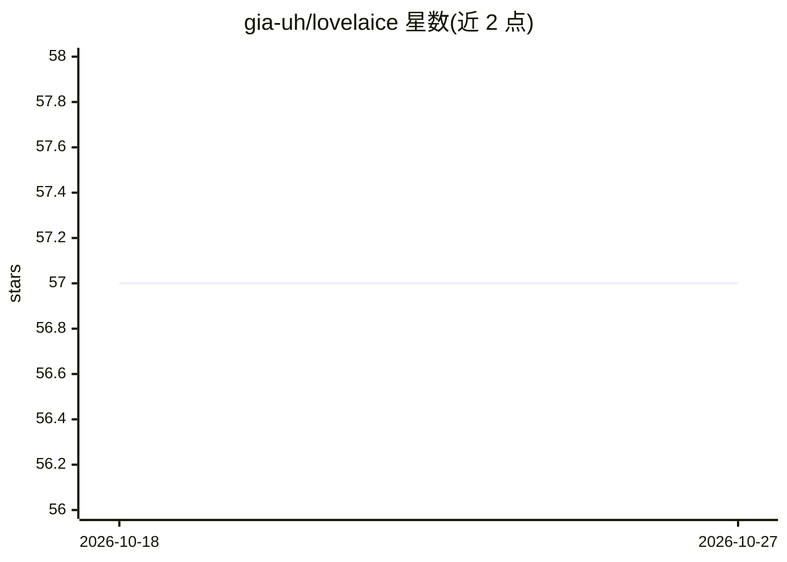

# gia-uh/lovelaice

⭐ 57 · Python · MIT · 推送 2026-10-18 · [GitHub](https://github.com/gia-uh/lovelaice) · 个人维护

**终端与编辑器用的本地优先 AI 编码代理**

面向终端用户的编码代理：原生工具调用 ReAct 循环（read/bash/write/edit/glob/list_dir 等），默认 yolo 模式。提供三种运行方式：一次性命令行执行、Agent Client Protocol v1 服务器（可被 aegis、Zed 等 ACP 客户端驱动）、以及作为 Python 库嵌入引擎。模型接入通过 OpenRouter API key，配置文件 .lovelaice.py 用于锚定工作区与注册自定义工具/命令，支持 MCP stdio 服务器与 OpenRouter 推理透传。

## 筛选速览

| 维度 | 判定 | 备注 |
|---|---|---|
| AI 角色 | `ai-native` | 本体是模型或模型工具 |
| 许可风险 | `permissive` | MIT |
| 部署形态 | `None` |  |
| 模型依赖 | locked-api |  |
| 硬件要求 | — | 无带数字的原话,不猜 |
| 安装摩擦 | `low` | 无编译、无系统依赖或容器化 |
| 成熟度 | — | 结构信号不足 |

## 能力要点

- 原生工具调用 ReAct 循环（bash/read/write/edit/glob/grep/fetch 等）
- Agent Client Protocol v1 服务器，可被 Zed 等 ACP 客户端驱动
- Config 装饰器注册自定义工具与命令，可扩展
- 支持 stdio MCP 服务器工具接入与推理透传（thinking 模式）

## 适用场景

- 在终端用一句话让代理完成读写文件、执行命令等编码任务
- 通过 Zed 等 ACP 客户端将其作为无 harness 的本地代理使用
- 以 Python 库形式把代理引擎嵌入自己的程序

## 场景标签

`编码 Agent` · 领域:编码与开发

## 证据(README 行号)

> L3: A sovereign, local-first coding agent for the terminal. A native
> L4: tool-calling ReAct loop (read/bash/write/edit/glob/list_dir), yolo by default.

## 星数曲线

2026-10-18 57 → 2026-10-27 57（+0）

---
*卡片 v1 · prompt 1.4 · 生成 2026-10-24 · 置信度 high · 依据 README sha `7b0578d36cbe` · [字段定义](../../DATASET.md)*
