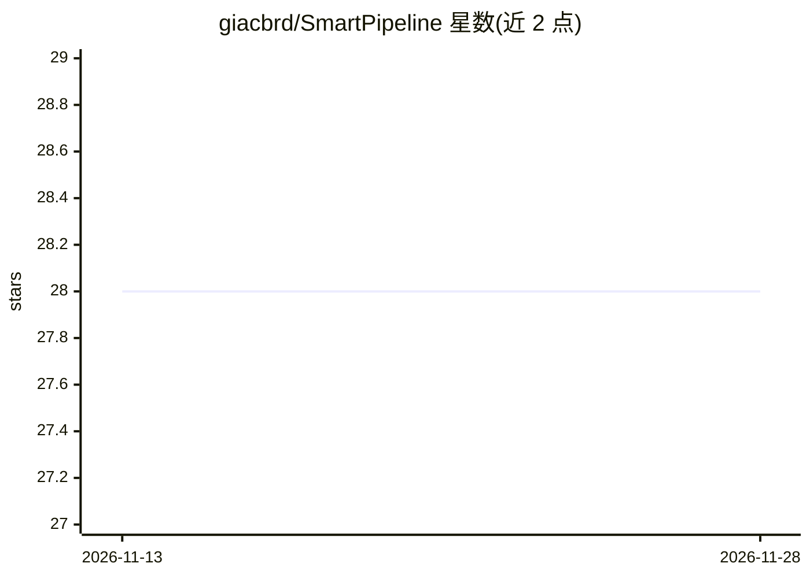

# giacbrd/SmartPipeline

⭐ 28 · Python · LGPL-3.0 · 推送 2026-11-13 · [GitHub](https://github.com/giacbrd/SmartPipeline) · [官网](https://smartpipeline.readthedocs.io) · 个人维护

**给开发者的轻量数据流水线框架：阶段化构建健壮 ETL**

Python 数据流水线框架：将每个任务封装为 pipeline stage，按生产者-消费者模式组织，各 stage 可独立设置并发、支持批处理与单条异步处理，并在 stage 级别定制错误处理与监控日志。面向小中型项目、原型与生产代码，定位为在大型任务队列和工作流框架过剩时的替代方案。无任何依赖，从 PyPI 安装。示例中演示了从 RSS 源抓取新闻并用 SentenceTransformer 生成文本嵌入的流水线。

## 筛选速览

| 维度 | 判定 | 备注 |
|---|---|---|
| AI 角色 | `ai-ecosystem` | LLM/agent 周边工具 |
| 许可风险 | `viral` | LGPL-3.0 |
| 部署形态 | `library` | 以包/库形式分发 |
| 模型依赖 | — | README 未给出锁定关系 |
| 硬件要求 | — | 无带数字的原话,不猜 |
| 安装摩擦 | `low` | 无编译、无系统依赖或容器化 |
| 成熟度 | — | 结构信号不足 |

## 能力要点

- 阶段化流水线，各 stage 可独立设置并发运行
- 支持批处理（BatchStage）与单条异步处理
- stage 级别错误处理与监控定制
- 零依赖，本地数据处理时最小化序列化与复制

## 适用场景

- 快速搭建小中型数据分析原型或 POC
- 在不想引入大型工作流框架时替代裸脚本
- 持续处理数据源（如抓取与向量化文本）

## 场景标签

`工作流自动化` · 领域:效率与自动化

## 证据(README 行号)

> L24: SmartPipeline gives you the tools to design simple data pipelines,
> L100:  class NewsEmbedding(BatchStage[NewsData]):

## 星数曲线

2026-11-13 28 → 2026-11-28 28（+0）

---
*卡片 v1 · prompt 1.4 · 生成 2026-11-18 · 置信度 mid · 依据 README sha `c62de91d2e6e` · [字段定义](../../DATASET.md)*
