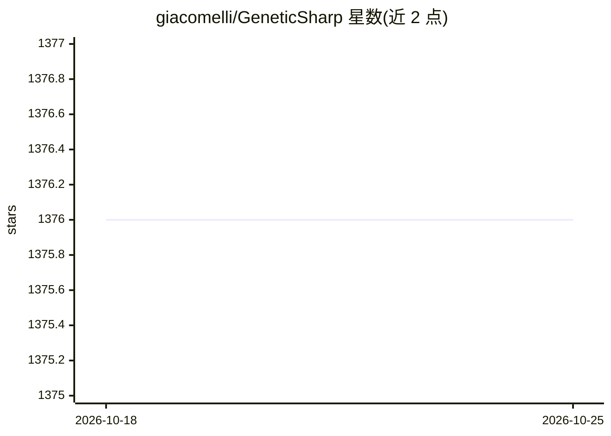

# giacomelli/GeneticSharp

⭐ 1,376 · C# · MIT · 推送 2025-11-13 · [GitHub](https://github.com/giacomelli/GeneticSharp) · 个人维护

**C# 遗传算法库：为 .NET 应用提供多平台遗传算法开发框架**

面向 .NET 开发者的遗传算法（GA）库，以 C# 编写，支持 .NET 6、.NET Standard 2.0、.NET Framework 4.6.2、Mono 及 Unity3D。内置染色体、适应度、种群、6 种选择、12 种交叉、7 种变异、重插入、终止条件与并行任务执行器等组件，各组件均可通过实现接口扩展。通过 NuGet 安装，另提供 dotnet new 项目模板与 Blazor/GTK#/Unity3D/控制台示例；README 列出大量使用该库的论文与项目。代码为库形式，无需编译交付物，自身无系统级依赖之外要求。

## 筛选速览

| 维度 | 判定 | 备注 |
|---|---|---|
| AI 角色 | `ai-native` | 本体是模型或模型工具 |
| 许可风险 | `permissive` | MIT |
| 部署形态 | `desktop` | 安装包/桌面程序 |
| 模型依赖 | — | README 未给出锁定关系 |
| 硬件要求 | — | 无带数字的原话,不猜 |
| 安装摩擦 | `medium` | 含编译或系统依赖之一 |
| 成熟度 | — | 结构信号不足 |

## 能力要点

- 覆盖选择/交叉/变异/重插入/终止等 GA 全组件，均支持接口扩展
- 多线程执行（ParallelTaskExecutor/TplTaskExecutor）
- 支持 .NET 6/.NET Standard/Mono/.NET Framework 与 Unity3D，Windows/MacOS 均测试
- 提供 NuGet 包与 4 个 dotnet new 项目模板

## 适用场景

- 在 .NET 应用中实现函数优化、TSP、调度等优化问题
- Unity3D 游戏中使用遗传算法做寻路或关卡生成
- 通过实现 IFitness 与自定义染色体快速搭建自己的 GA

## 场景标签

 · 领域:算法库/优化

## 证据(README 行号)

> L8: GeneticSharp is a fast, extensible, multi-platform, and multithreading C# Genetic Algorithm library that simplifies 
> L10: It can be used in any kind of .NET 6, .NET Standard, and .NET Framework apps, like ASP .NET MVC, ASP .NET Core, Bla

## 星数曲线

2026-10-18 1,376 → 2026-10-25 1,376（+0）

---
*卡片 v1 · prompt 1.4 · 生成 2026-10-21 · 置信度 high · 依据 README sha `17b190da595f` · [字段定义](../../DATASET.md)*
