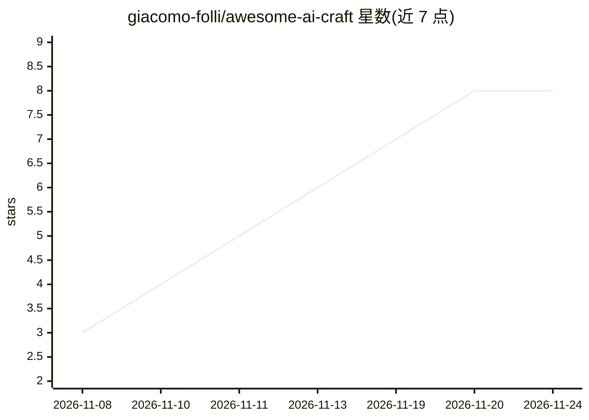

# giacomo-folli/awesome-ai-craft

⭐ 8 · CC0-1.0 · 推送 2026-11-20 · [GitHub](https://github.com/giacomo-folli/awesome-ai-craft) · 个人维护

**AI 净室逆向重实现软件产品的策展清单**

收录通过 AI 编码代理驱动的净室重实现、逆向工程与 agentic 工作流产出的软件产品，按创意媒体套件、办公套件、音视频与 CAD、编译器与引擎重写、参数化 3D 工程、游戏重实现、逆向工程代理工具等类别组织，共约 30 个条目。清单还描述净室方法论流程（规范提取→净室屏障→代理原生架构/MCP 集成），并链接社区讨论与其他相关清单。内容为条目列表与简要说明，不含安装指南。

## 筛选速览

| 维度 | 判定 | 备注 |
|---|---|---|
| AI 角色 | `ai-knowledge` | 知识聚合/清单类 |
| 许可风险 | `viral` | CC0-1.0 |
| 部署形态 | `None` |  |
| 模型依赖 | — | README 未给出锁定关系 |
| 硬件要求 | — | 无带数字的原话,不猜 |
| 安装摩擦 | `low` | 无编译、无系统依赖或容器化 |
| 成熟度 | — | 结构信号不足 |

## 能力要点

- 按 Adobe/微软等替代品与游戏重实现等类别组织的条目清单
- 三步净室方法论：规范提取、净室屏障、代理原生 MCP 架构
- 收录 REA、IDA Pro MCP、GhidraMCP 等逆向工程代理工具
- 含字节匹配级游戏反编译项目条目

## 适用场景

- 寻找商业软件的开源净室重实现替代品
- 调研 AI 代理参与逆向工程与重编译的项目案例
- 了解净室重实现的方法论与工具链

## 场景标签

`精选清单` · 领域:学习与行业

## 证据(README 行号)

> L3: > Software products, applications, and desktop suites created through AI-driven clean-room reimplementation, reverse
> L5: ## Contents
> L44: *Frameworks, compilers, parsers, and engines rebuilt or ported mostly by coding agents, with humans directing the w

## 星数曲线

2026-11-08 3 → 2026-11-24 8（+5）

---
*卡片 v1 · prompt 1.4 · 生成 2026-11-20 · 置信度 high · 依据 README sha `64777810b769` · [字段定义](../../DATASET.md)*
