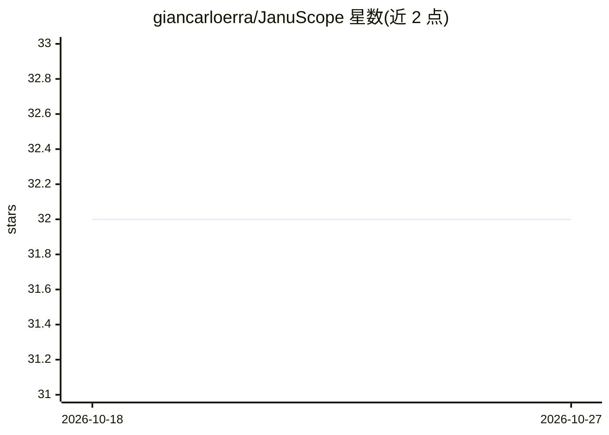

# giancarloerra/JanuScope

⭐ 32 · TypeScript · AGPL-3.0 · 推送 2026-10-23 · [GitHub](https://github.com/giancarloerra/JanuScope) · [官网](https://januscope.com) · 个人维护

**本地 MCP 策略代理：用一份 YAML 给任意 MCP 服务器加安全护栏**

JanuScope 是运行在本地的 MCP 策略代理：通过一份 YAML 配置（Lens）包裹任意 MCP 服务器，提供工具封禁、SQL 变更拦截、PII 脱敏、审计日志、限流、OpenTelemetry、vault 密钥、首次使用隔离与数据库 schema 预注入（减少模型探索性调用）。数据路径中不含托管网关。内置 20 个 Lens，覆盖 Postgres、MySQL、MongoDB、Snowflake、GitHub、Stripe 等数据库、SaaS API 与文件系统。通过 npx 免安装运行，仅需 Node.js 20+，兼容 Claude Code、VSCode Copilot、Cursor 等 MCP 客户端。基准测试称减少 84% token 消耗（README 亦声明该结果不构成会话保留或普适性结论）。

## 筛选速览

| 维度 | 判定 | 备注 |
|---|---|---|
| AI 角色 | `ai-ecosystem` | LLM/agent 周边工具 |
| 许可风险 | `dual` | AGPL-3.0 |
| 部署形态 | `library` | 以包/库形式分发 |
| 模型依赖 | — | README 未给出锁定关系 |
| 硬件要求 | — | 无带数字的原话,不猜 |
| 安装摩擦 | `medium` | 含编译或系统依赖之一 |
| 成熟度 | — | 结构信号不足 |

## 能力要点

- 一份 YAML（Lens）包裹任意 MCP 服务器，无需修改上游服务器
- 工具封禁、SQL 变更拦截（sqlGuard）、PII 脱敏、JSONL 审计日志
- schema 预注入减少模型发现性调用，基准称 84% fewer tokens
- 内置 20 个 Lens 覆盖数据库、SaaS API、源码管理与文件系统

## 适用场景

- 给数据库 MCP 加只读/写拦截策略，防止 AI agent 执行破坏性操作
- 在模型读取前脱敏返回值中的 PII（如邮箱）
- 为 MCP 调用记录可追溯的审计日志
- 复用现成 Lens 快速加固 Claude Code/Cursor 等客户端的 MCP 配置

## 场景标签

`网络安全` `LLM 可观测性` · 领域:评测与运维

## 证据(README 行号)

> L14: **JanuScope is the local MCP policy proxy. One YAML wraps any MCP server with policy, redaction, audit, and databas
> L18: One YAML (called a **Lens**) wraps any MCP server with **security guardrails, schema injection**, and **full audit 

## 星数曲线

2026-10-18 32 → 2026-10-27 32（+0）

---
*卡片 v1 · prompt 1.4 · 生成 2026-10-26 · 置信度 high · 依据 README sha `7e2e7d23b4e4` · [字段定义](../../DATASET.md)*
