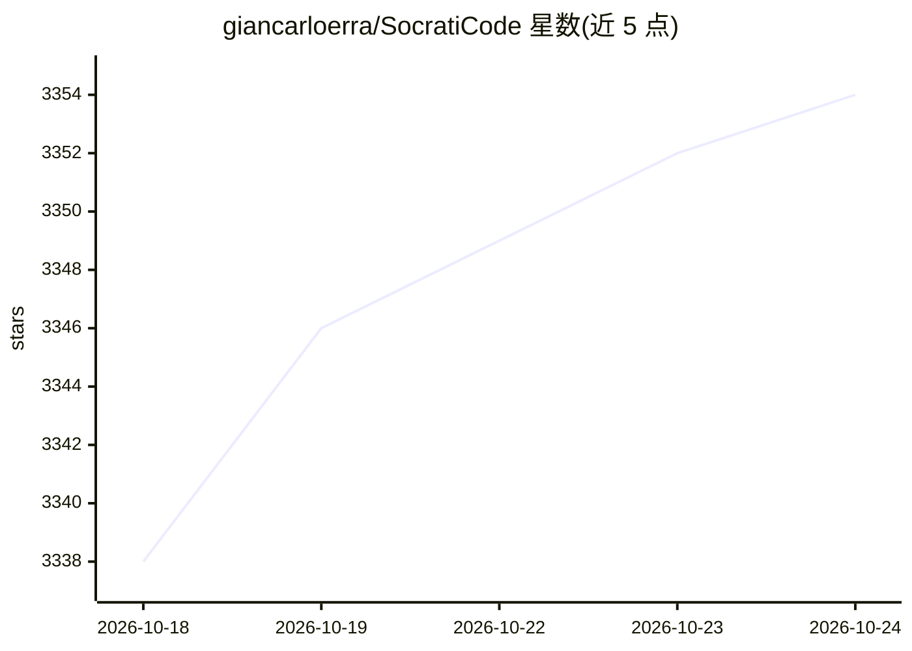

# giancarloerra/SocratiCode

⭐ 3,354 · TypeScript · AGPL-3.0 · 推送 2026-10-23 · [GitHub](https://github.com/giancarloerra/SocratiCode) · [官网](https://socraticode.cloud) · 个人维护

**给 AI 助手的代码库上下文引擎：零配置本地索引与语义检索**

面向 AI 编码助手的开源代码库上下文引擎，以 MCP 服务器、Claude Code 插件或 VS Code/Cursor 扩展形式接入。功能包括混合语义+BM25 检索（RRF 融合）、AST 感知分块、18 种语言的依赖图与符号级影响分析（blast-radius、调用流）、交互式 HTML 图浏览器，以及数据库/API/基础设施文档的可搜索工件。默认通过 Docker 自动管理本地 Qdrant 与 Ollama，无需 API key，数据不离开本机；索引支持断点续传、文件监听增量更新与多仓库多分支。需 Node.js 18.17+ 与 Docker。

## 筛选速览

| 维度 | 判定 | 备注 |
|---|---|---|
| AI 角色 | `ai-ecosystem` | LLM/agent 周边工具 |
| 许可风险 | `viral` | AGPL-3.0 |
| 部署形态 | `self-host` | docker 或自建部署 |
| 模型依赖 | local-ok | 支持本地模型 |
| 硬件要求 | — | 无带数字的原话,不猜 |
| 安装摩擦 | `low` | 无编译、无系统依赖或容器化 |
| 成熟度 | — | 结构信号不足 |

## 能力要点

- 混合语义+BM25（RRF 融合）代码检索与 AST 感知分块
- 18 种语言的符号级影响分析与调用流追踪
- 断点续传索引与文件监听自动增量更新，支持千万行级仓库
- 默认本地 Docker 管理 Qdrant 与 Ollama，无 API key、数据不出本机

## 适用场景

- 让 Claude Code/VS Code/Cursor 等 AI 助手快速理解大型代码库
- 改动前做符号级影响分析与依赖可视化
- 跨项目、跨分支检索代码与基础设施/API/数据库文档

## 场景标签

`语义搜索` `RAG` · 领域:知识与检索

## 证据(README 行号)

> L36: **One thing, done well: deep codebase intelligence with zero setup, no bloat, and full automation.** SocratiCode gi
> L44: The first Qdrant‑based MCP/Claude Plugin/Skill that pairs auto‑managed, zero‑config local Docker deployment with **
> L110: SocratiCode can be installed as a native agent plugin, a VS Code editor extension, or a directly configured local 

## 星数曲线

2026-10-18 3,338 → 2026-10-24 3,354（+16）

---
*卡片 v1 · prompt 1.4 · 生成 2026-10-20 · 置信度 high · 依据 README sha `00a146e5221a` · [字段定义](../../DATASET.md)*
