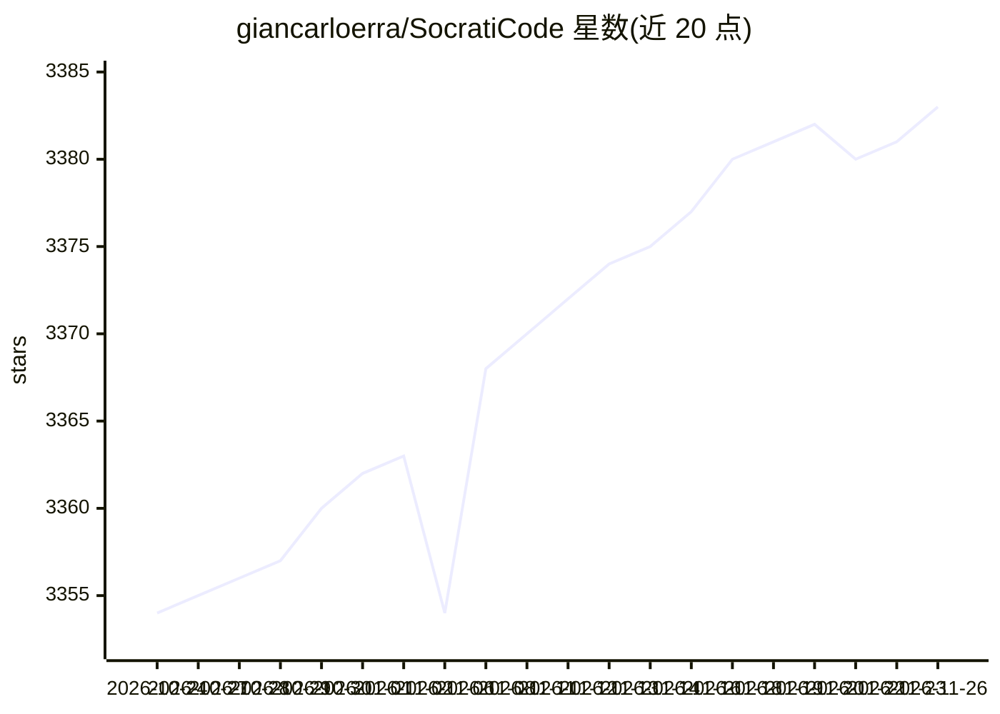

# giancarloerra/SocratiCode

⭐ 3,383 · TypeScript · AGPL-3.0 · 推送 2026-11-22 · [GitHub](https://github.com/giancarloerra/SocratiCode) · [官网](https://socraticode.cloud) · 个人维护

**给 AI 助手提供代码库语义检索与依赖图分析的 MCP 引擎**

以 MCP 服务器、Claude Code/Codex 插件和 VS Code 扩展形式发布的代码库上下文引擎：提供混合语义+BM25 检索、多语言依赖图、符号级影响分析与调用流追踪、HTML 图谱查看器，以及数据库/API/基础设施配置的可搜索上下文。默认本地 Docker 运行 Qdrant 与 Ollama，无需 API key，数据不出本机；支持断点续传索引、文件监视自动更新与多分支多仓库索引。要求 Node.js 18.17+，采用 AGPL-3.0 许可，另有 Cloud 私测托管版。

## 筛选速览

| 维度 | 判定 | 备注 |
|---|---|---|
| AI 角色 | `ai-ecosystem` | LLM/agent 周边工具 |
| 许可风险 | `viral` | AGPL-3.0 |
| 部署形态 | `self-host` | docker 或自建部署 |
| 模型依赖 | local-ok | 支持本地模型 |
| 硬件要求 | — | 无带数字的原话,不猜 |
| 安装摩擦 | `low` | 无编译、无系统依赖或容器化 |
| 成熟度 | — | 结构信号不足 |

## 能力要点

- 18 种语言的 AST 感知分块与混合语义+BM25（RRF 融合）检索
- 符号级影响分析、blast-radius 与调用流追踪及循环依赖可视化
- 批处理可断点续传索引，文件监视器自动保持索引更新
- 多智能体共享同一索引并自动协调，零配置

## 适用场景

- 让 Claude Code/VS Code 里的 AI 助手理解 4000 万行级企业代码库
- 在改动前查询某个符号的影响范围与调用链
- 把数据库 schema、API 规范、基础设施配置纳入 AI 可检索上下文
- 多个 AI 智能体同时在同一代码库上协作开发

## 场景标签

`编码 Agent` `AI 助手` `多智能体` · 领域:Agent 开发

## 证据(README 行号)

> L36: **One thing, done well: deep codebase intelligence with zero setup, no bloat, and full automation.** SocratiCode gi
> L52: > **Requirements:** Node.js 18.17 or newer with `npx` on `PATH`, plus Docker running for the default local Qdrant a
> L110: SocratiCode can be installed as a native agent plugin, a VS Code editor extension, or a directly configured local 

## 星数曲线

2026-10-24 3,354 → 2026-11-26 3,383（+29）

---
*卡片 v1 · prompt 1.4 · 生成 2026-11-23 · 置信度 high · 依据 README sha `ede7996f17db` · [字段定义](../../DATASET.md)*
