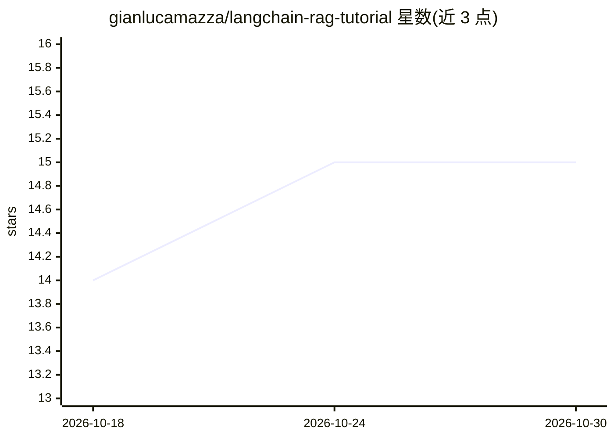

# gianlucamazza/langchain-rag-tutorial

⭐ 15 · Jupyter Notebook · MIT · 推送 2026-10-26 · [GitHub](https://github.com/gianlucamazza/langchain-rag-tutorial) · 个人维护

**LangChain RAG 动手教程：20 个 notebook 覆盖从基础到高级模式**

面向学习者的 RAG 教程仓库：notebook 01–03 讲文档加载、嵌入比较与简单 RAG，04–20 演示 Memory、HyDE、Corrective/Adaptive/Self/Agentic RAG、SQL、GraphRAG、多模态、嵌入微调、混合检索与 RAGAS 评测等模式，并提供 Docker Compose、FastAPI、Streamlit、AWS Lambda 教学模板。栈为 LangChain 1.x + OpenAI，向量库用 FAISS。README 明确声明是学习仓库而非生产系统，notebook 11 为定性比较而非基准。

## 筛选速览

| 维度 | 判定 | 备注 |
|---|---|---|
| AI 角色 | `ai-knowledge` | 知识聚合/清单类 |
| 许可风险 | `permissive` | MIT |
| 部署形态 | `self-host` | docker 或自建部署 |
| 模型依赖 | — | README 未给出锁定关系 |
| 硬件要求 | — | 无带数字的原话,不猜 |
| 安装摩擦 | `low` | 无编译、无系统依赖或容器化 |
| 成熟度 | — | 结构信号不足 |

## 能力要点

- 20 个 notebook 覆盖 Memory/HyDE/CRAG/GraphRAG/多模态等 RAG 模式
- RAGAS 评测 notebook（忠实度、相关性、上下文精度/召回）
- Docker/FastAPI/Streamlit/Lambda 教学部署模板
- shared/ 可复用助手库与无需 API key 的单元测试

## 适用场景

- 系统学习 LangChain RAG 从基础到高级的实现模式
- 按场景挑选 notebook（如 SQL 问答、多模态检索、混合检索）
- 以模板为起点搭建 RAG 原型并做 RAGAS 评测

## 场景标签

`RAG` `教程课程` · 领域:知识与检索

## 证据(README 行号)

> L10: Hands-on tutorial for building **Retrieval-Augmented Generation (RAG)** systems with LangChain 1.x.
> L15: This is a learning repo, not a finished product you can drop into production.
> L125: - Fundamentals through GraphRAG, multimodal RAG, embedding fine-tuning, hybrid/rerank, parent/multi-vector, and RA

## 星数曲线

2026-10-18 14 → 2026-10-30 15（+1）

---
*卡片 v1 · prompt 1.4 · 生成 2026-10-30 · 置信度 mid · 依据 README sha `d3f6bbec6b22` · [字段定义](../../DATASET.md)*
