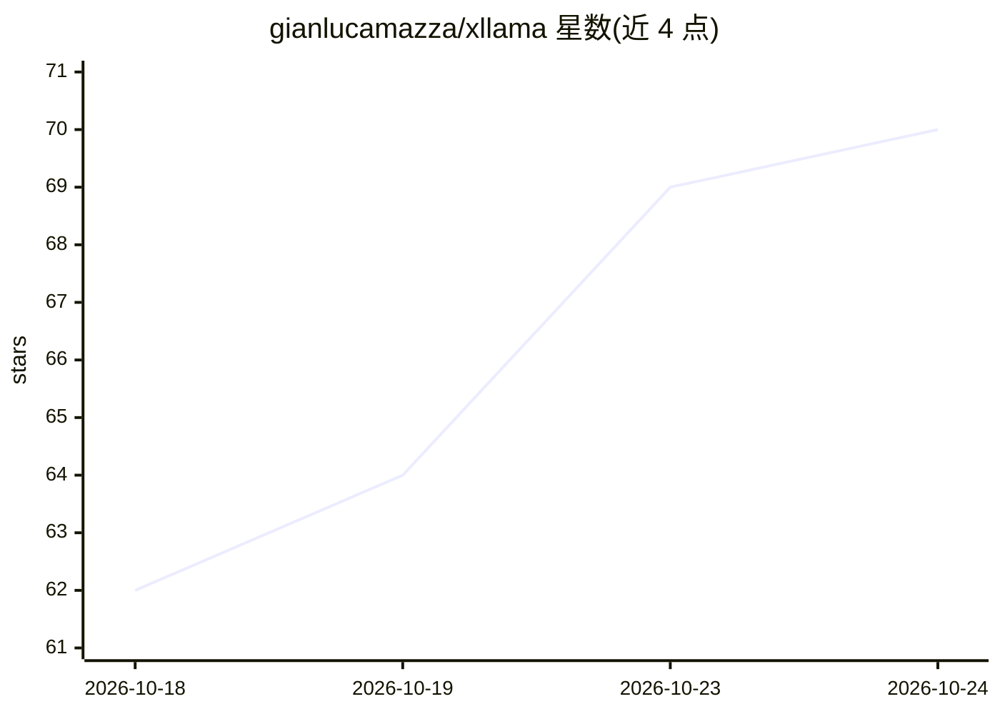

# gianlucamazza/xllama

⭐ 70 · C++ · MIT · 推送 2026-10-21 · [GitHub](https://github.com/gianlucamazza/xllama) · [官网](https://huggingface.co/collections/gianlucamazza/xllama-models-measured-on-xbox-series-s) · 个人维护

**在 Xbox Series S|X Dev Mode 上本地运行 LLM 的推理运行时**

面向 Xbox Series S|X 开发者模式的本地推理引擎：双后端（ONNX Runtime GenAI + DirectML 与 llama.cpp + GGUF）按模型在运行时分发调度，提供基准测试（tok/s、内存/带宽探针）、SD-Turbo 扩散生图、设备端部分微调（PEFT），以及可选开启的 OpenAI/Ollama 兼容 LAN HTTP 端点。构建目标为游戏 NPC/对话/agent 与 AI 助手场景。受 UWP/AppContainer 约束（无 mmap/dlopen、单驻留会话、统一 10 GB 内存预算），仅限 Dev Mode，无零售路径。安装通过 release 资产/MSIX 或 Linux 端 cmake 源码编译，首次启动下载默认模型约 219 MB。独立研究项目，与 Microsoft 无关联。

## 筛选速览

| 维度 | 判定 | 备注 |
|---|---|---|
| AI 角色 | `ai-ecosystem` | LLM/agent 周边工具 |
| 许可风险 | `permissive` | MIT |
| 部署形态 | `None` |  |
| 模型依赖 | local-ok | 支持本地模型 |
| 硬件要求 | — | 无带数字的原话,不猜 |
| 安装摩擦 | `medium` | 含编译或系统依赖之一 |
| 成熟度 | `idea` | |

## 能力要点

- ORT GenAI+DirectML 与 llama.cpp+GGUF 双后端按模型运行时分发
- OpenAI/Ollama 兼容 LAN 端点（默认关闭，含 completions/embeddings/生图路由）
- 设备端部分微调（Lane B）与宿主 PEFT 训练（Lane A）、合并 GGUF 服务（Lane C）
- SD-Turbo 扩散生图跑在 DirectML 上

## 适用场景

- 在 Xbox Dev Mode 上本地跑小型 GGUF/ONNX 模型做对话或推理测试
- 游戏开发者在主机上为 NPC/对话原型接入本地 LLM API
- 测量主机平台（Zen2/RDNA2/统一内存）上的 LLM 推理性能

## 场景标签

`推理引擎` `微调` `图像生成` · 领域:内容生成

## 证据(README 行号)

> L3: > Local inference on Xbox Series S|X — GGUF / llama.cpp, dual-backend dispatch
> L67: xllama exposes an HTTP endpoint on the local network that exposes its full
> L68: inference core (`SessionHub`) with OpenAI and Ollama-compatible APIs.

## 星数曲线

2026-10-18 62 → 2026-10-24 70（+8）

---
*卡片 v1 · prompt 1.4 · 生成 2026-10-24 · 置信度 high · 依据 README sha `9811bc72bfc6` · [字段定义](../../DATASET.md)*
