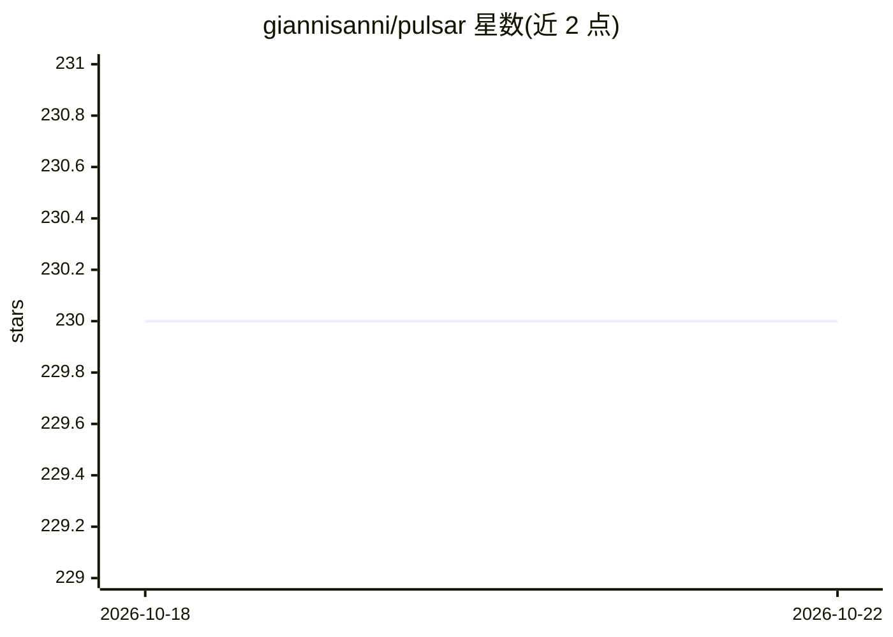

# giannisanni/pulsar

⭐ 230 · Rust · NOASSERTION · 推送 2026-09-01 · [GitHub](https://github.com/giannisanni/pulsar) · 个人维护

**在消费级多 GPU 上运行巨型 MoE 模型的 SSD 流式推理引擎**

用 Rust + CUDA 编写的本地推理引擎，针对消费级显存放不下的巨型 MoE 模型：路由专家驻留 NVMe 逐 token 流式读取，决策部分（注意力、路由）常驻显存；启动时实测各卡 PCIe 带宽并自动放置注意力与热专家，实现零配置多 GPU。当前支持 11 种模型架构（GLM-5.2 743B、Kimi K2.7 1T、Hy3 295B、Qwen3-235B 等），使用 GGUF 量化权重，支持 K-quants、IQ 系列量化，可选 CPU 专家通道与投机解码。参考机为 2×16GB 显卡 + Gen5 NVMe；首个运行为冷启动（专家热度普查未建立），解码速率随输出长度下降。

## 筛选速览

| 维度 | 判定 | 备注 |
|---|---|---|
| AI 角色 | `ai-ecosystem` | LLM/agent 周边工具 |
| 许可风险 | `none` | NOASSERTION |
| 部署形态 | `None` |  |
| 模型依赖 | — | README 未给出锁定关系 |
| 硬件要求 | — | 无带数字的原话,不猜 |
| 安装摩擦 | `high` | 编译与系统依赖俱全 |
| 成熟度 | — | 结构信号不足 |

## 能力要点

- 专家权重驻留 NVMe、逐 token SSD 流式读取的推理路径
- 零配置多 GPU：启动时实测 PCIe 带宽并据此放置注意力与热专家
- 支持 11 种巨型 MoE 架构（743B/1T 级）在 2×16GB 消费级 GPU 上运行
- 可选 CPU 专家通道（AVX2 量化核）与 nextn/MTP 投机解码

## 适用场景

- 在两张 16GB 消费级显卡上本地运行数百至上千亿参数的 MoE 模型
- 显存不足时用 NVMe 流式方式跑 GGUF 量化大模型
- 利用多张异构显卡零配置搭建本地推理环境

## 场景标签

`推理引擎` · 领域:训练与推理

## 证据(README 行号)

> L5: An inference engine for giant Mixture-of-Experts models on hardware that
> L198: **Zero-config multi-GPU.** At startup pulsar *measures* each card's H2D

## 星数曲线

2026-10-18 230 → 2026-10-22 230（+0）

---
*卡片 v1 · prompt 1.4 · 生成 2026-10-22 · 置信度 high · 依据 README sha `40d07e9d30b1` · [字段定义](../../DATASET.md)*
