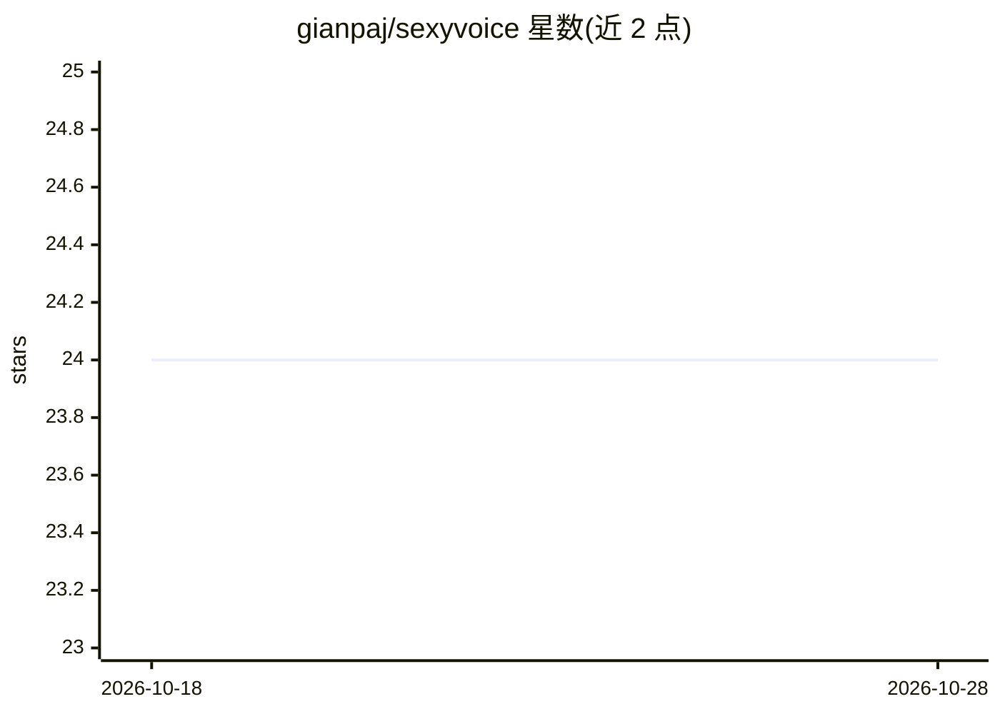

# gianpaj/sexyvoice

⭐ 24 · TypeScript · NOASSERTION · 推送 2026-10-28 · [GitHub](https://github.com/gianpaj/sexyvoice) · [官网](https://sexyvoice.ai) · 个人维护

**AI 语音生成与克隆 Web 平台：TTS、克隆与语音通话**

SexyVoice.ai 是基于 Next.js 16 + Supabase 的 AI 语音平台源码：文本转语音支持 24+ 语言、63 个 Google Gemini 与 xAI Grok 公共声音，10 秒音频即可克隆自己的声音（20+ 语言），含基于 Whisper 的离线音频转写（99+ 语言）、基于 LiveKit 的实时语音通话、信用额度计费（Stripe）、Google 登录与 i18n。依赖多个第三方 API（Replicate/fal.ai/Google/xAI）与 Supabase、Cloudflare R2 等外部服务，自部署需配置大量环境变量。

## 筛选速览

| 维度 | 判定 | 备注 |
|---|---|---|
| AI 角色 | `ai-native` | 本体是模型或模型工具 |
| 许可风险 | `none` | NOASSERTION |
| 部署形态 | `library` | 以包/库形式分发 |
| 模型依赖 | locked-api |  |
| 硬件要求 | — | 无带数字的原话,不猜 |
| 安装摩擦 | `low` | 无编译、无系统依赖或容器化 |
| 成熟度 | — | 结构信号不足 |

## 能力要点

- 24+ 语言 TTS，63 个 Gemini/Grok 公共声音
- 10 秒音频克隆声音，支持 20+ 语言
- Whisper 离线转写，支持 99+ 语言
- LiveKit 实时语音通话与通话转录分析

## 适用场景

- 内容创作者生成多语言配音音频
- 克隆自己的声音用于创作或叙事
- 搭建带计费与登录的语音生成 SaaS 站点
- 离线转写音频文件并翻译为英文

## 场景标签

`语音合成` `语音 Agent` `语音识别` · 领域:对话与助手

## 证据(README 行号)

> L18: - Generate AI voices in 24+ supported languages and locales
> L32: - **AI Voice Generation**: Create realistic voices powered by Google Gemini, xAI Grok, and additional TTS models
> L34: - **Voice Selection System**: Choose from 63 public voices: Gemini voices such as `achernar`, `kore`, `puck`, and `

## 星数曲线

2026-10-18 24 → 2026-10-28 24（+0）

---
*卡片 v1 · prompt 1.4 · 生成 2026-10-27 · 置信度 mid · 依据 README sha `8c285aafe8c5` · [字段定义](../../DATASET.md)*
