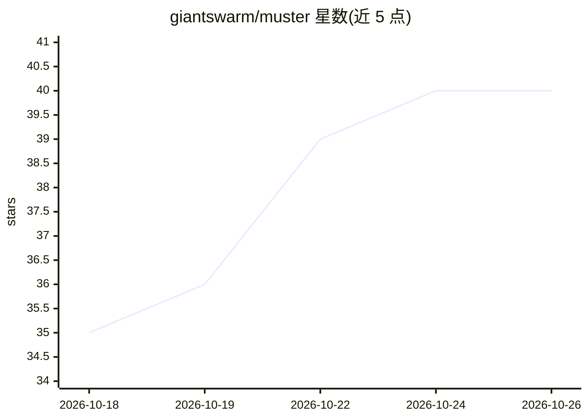

# giantswarm/muster

⭐ 40 · Go · Apache-2.0 · 推送 2026-10-25 · [GitHub](https://github.com/giantswarm/muster) · [官网](https://giantswarm.github.io/muster/) · 组织维护

**MCP 服务器聚合网关：单端点统一接入组织全部 MCP 工具**

面向团队与平台的 MCP（Model Context Protocol）聚合服务器：连接 stdio、streamable-http、sse 后端 MCP 服务器，健康检查与重连，把全部工具通过单一 MCP 端点暴露；客户端经 13 个元工具（list_tools/filter_tools/call_tool 等）分页发现并以少量 token 定位工具。提供 Toolset 工具面控制、OAuth 2.1 + Dex 单点登录与身份透传、Kubernetes 自定义资源（MCPServer/Workflow/WorkflowExecution）与 Helm 部署、OpenTelemetry/Prometheus 可观测性。可作为单二进制在本机桥接 IDE，也可作为组织级网关运行。

## 筛选速览

| 维度 | 判定 | 备注 |
|---|---|---|
| AI 角色 | `ai-ecosystem` | LLM/agent 周边工具 |
| 许可风险 | `permissive` | Apache-2.0 |
| 部署形态 | `library` | 以包/库形式分发 |
| 模型依赖 | — | README 未给出锁定关系 |
| 硬件要求 | — | 无带数字的原话,不猜 |
| 安装摩擦 | `low` | 无编译、无系统依赖或容器化 |
| 成熟度 | — | 结构信号不足 |

## 能力要点

- 聚合 stdio/streamable-http/sse 三类 MCP 服务器并自动重连
- 13 个元工具实现分页、按相关性排序的低 token 工具发现
- OAuth 2.1 资源服务器 + Dex SSO，下游调用以本人身份执行
- Kubernetes 自定义资源与 Helm chart 部署，含 Prometheus 规则与 Grafana 面板

## 适用场景

- 为组织内多个 MCP 服务器提供统一认证入口
- 让 AI agent 在不加载全部工具定义的前提下发现和调用工具
- 把多步操作定义为确定性 workflow 工具并追踪执行记录
- 本机桥接 IDE 到本地与远程 MCP 服务器

## 场景标签

`模型网关` `工作流自动化` · 领域:Agent 开发

## 证据(README 行号)

> L14: muster is an aggregating Model Context Protocol server.
> L17: serves all of their tools through a single MCP endpoint. AI agents
> L21: It runs as a single binary on a laptop, bridging an IDE to local and remote MCP servers, and as a

## 星数曲线

2026-10-18 35 → 2026-10-26 40（+5）

---
*卡片 v1 · prompt 1.4 · 生成 2026-10-25 · 置信度 high · 依据 README sha `ef2835468600` · [字段定义](../../DATASET.md)*
