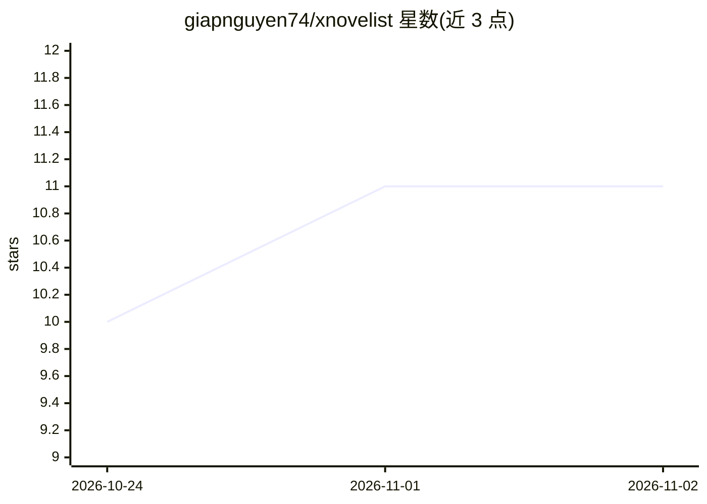

# giapnguyen74/xnovelist

⭐ 11 · TypeScript · MIT · 推送 2026-06-08 · [GitHub](https://github.com/giapnguyen74/xnovelist) · [官网](https://giapnguyen74.github.io/xnovelist/) · 个人维护

**本地优先的开源长篇小说写作工具，AI 可选且分级可控**

纯客户端静态网页应用（Next.js 静态导出），手稿存储于浏览器 IndexedDB，无后端、无账号、无自有服务器。无 AI 时即为完整写作工具：富文本编辑器、章节大纲、Story Bible、快照与行级 diff、DOCX 导出。AI 默认关闭，由 0-5 级别刻度控制介入深度，模型仅提出建议、用户接受后才写入；接入 OpenAI/Anthropic/OpenRouter 或本地 Ollama/LM Studio，浏览器直连模型，无代理不留密钥。给小说作者使用，尤其面向拒绝订阅制与在意隐私者。

## 筛选速览

| 维度 | 判定 | 备注 |
|---|---|---|
| AI 角色 | `ai-enhanced` | 去掉 AI 部分产品仍成立 |
| 许可风险 | `permissive` | MIT |
| 部署形态 | `library` | 以包/库形式分发 |
| 模型依赖 | local-ok | 支持本地模型 |
| 硬件要求 | — | 无带数字的原话,不猜 |
| 安装摩擦 | `low` | 无编译、无系统依赖或容器化 |
| 成熟度 | `idea` | |

## 能力要点

- 0-5 级 AI 介入刻度，L2 及以下不生成新文本
- AI 结果以提案形式呈现，用户接受后才写入稿件
- 纯客户端静态部署，手稿存于设备 IndexedDB，可完全离线
- 自带 API key 或指向本地模型（Ollama/LM Studio），支持任何 OpenAI Chat Completions 兼容端点

## 适用场景

- 在本地写长篇小说且不愿支付订阅费
- 按自己的偏好精确控制 AI 参与写作的程度
- 用本地模型实现全离线的 AI 辅助写作

## 场景标签

`AI 写作` · 领域:内容生成

## 证据(README 行号)

> L43: It works **fully without AI**: rich-text editor, chapter outline, Story Bible (characters, locations, voice, contin
> L58: This is how xnovelist stays neutral on the AI debate: AI is **off by default** and governed by a single dial — a wo

## 星数曲线

2026-10-24 10 → 2026-11-02 11（+1）

---
*卡片 v1 · prompt 1.4 · 生成 2026-11-02 · 置信度 high · 依据 README sha `1cdd026f3d14` · [字段定义](../../DATASET.md)*
