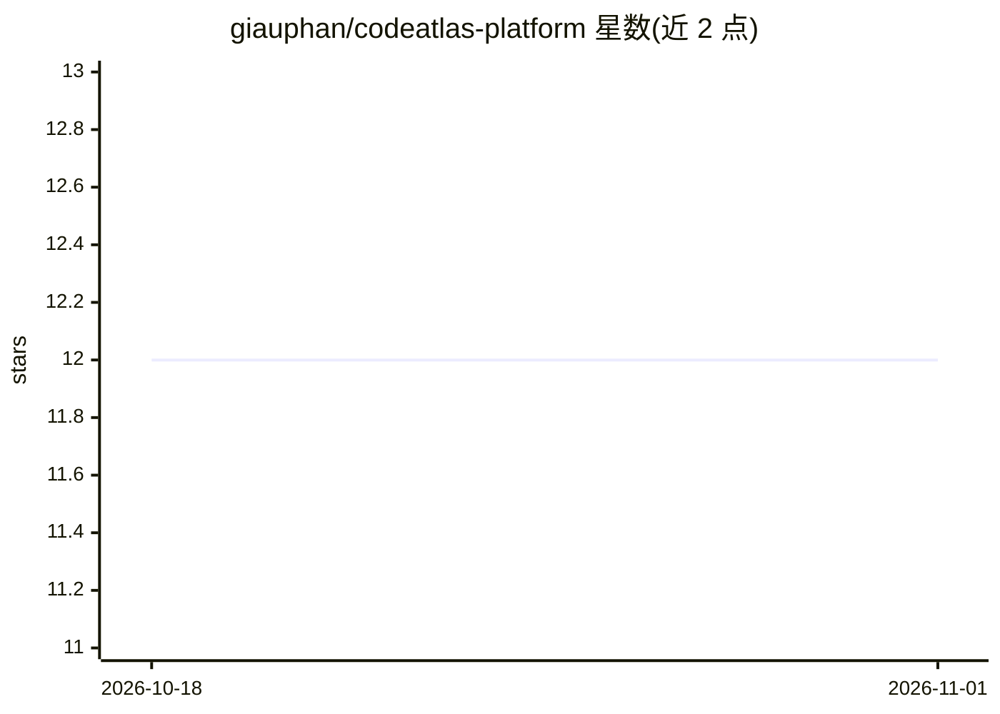

# giauphan/codeatlas-platform

⭐ 12 · TypeScript · MIT · 推送 2026-10-30 · [GitHub](https://github.com/giauphan/codeatlas-platform) · 个人维护

**给开发者的代码库智能平台：MCP Server + 知识图谱 + 语义记忆**

面向开发者的多租户代码库智能后端基础：通过 MCP Server（stdio/SSE，30+ 工具）向 Claude、Cursor、VSCode 等 AI IDE 提供代码搜索、AST 分析（TypeScript/Python/JS）、语义记忆（SQLite + sqlite-vec 向量检索）、知识图谱、漏洞扫描与 DeepWiki 架构文档生成。多租户依赖 Firebase 认证，向量检索依赖 NVIDIA NIM embeddings（无 key 时退化为按日期排序）。以源码方式部署：git clone 后用 pnpm 安装、构建并初始化数据库。README 声明其为起点基础，非生产级威胁模型的替代。

## 筛选速览

| 维度 | 判定 | 备注 |
|---|---|---|
| AI 角色 | `ai-ecosystem` | LLM/agent 周边工具 |
| 许可风险 | `permissive` | MIT |
| 部署形态 | `library` | 以包/库形式分发 |
| 模型依赖 | local-ok | 支持本地模型 |
| 硬件要求 | — | 无带数字的原话,不猜 |
| 安装摩擦 | `low` | 无编译、无系统依赖或容器化 |
| 成熟度 | `idea` | |

## 能力要点

- MCP Server 提供 30+ 工具，支持 stdio/SSE 传输（Claude/Cursor/VSCode）
- AST 分析支持 TypeScript/Python/JS 解析
- SQLite + sqlite-vec 语义记忆与知识图谱，无需外部数据库服务器
- DeepWiki 多提供商 LLM（Anthropic/OpenAI/Ollama）架构文档生成与问答

## 适用场景

- 为自己的 AI IDE 接入代码库搜索与语义记忆工具
- 搭建多租户的代码库智能分析后端
- 自动生成并查询代码库架构文档

## 场景标签

`知识图谱` `语义搜索` `代码审查` · 领域:编码与开发

## 证据(README 行号)

> L9: AI-powered codebase intelligence platform — MCP Server, AST analysis, Knowledge Graph, and semantic memory with SQLi
> L20: |**MCP Server**|30+ tools via stdio or SSE transport (Claude, Cursor, VSCode)|

## 星数曲线

2026-10-18 12 → 2026-11-01 12（+0）

---
*卡片 v1 · prompt 1.4 · 生成 2026-11-01 · 置信度 mid · 依据 README sha `2a82f1c1d104` · [字段定义](../../DATASET.md)*
