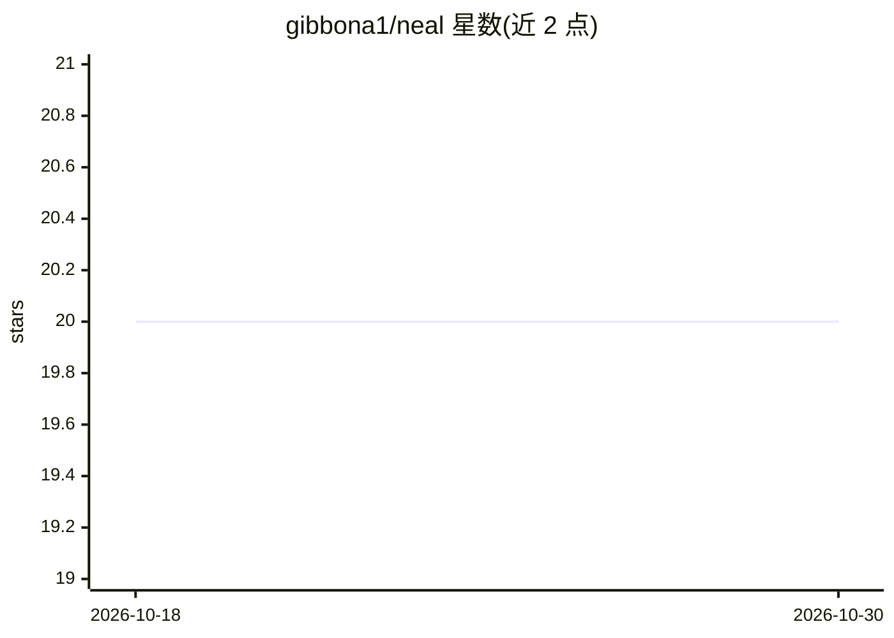

# gibbona1/neal

⭐ 20 · R · NOASSERTION · 推送 2026-07-12 · [GitHub](https://github.com/gibbona1/neal) · 组织维护

**面向专家与公民科学家的交互式音频标注工具（R/Shiny）**

NEAL 是基于 R 与 Shiny 框架构建的开源交互式音频标注工具，属于 Nature+Energy 项目。提供响应式界面，用户可快速标注音频文件并调整设置，界面元素随之自动变化；目标用户为专业鸟类观察者与公民科学家，用于声学标注项目。通过 renv 锁定依赖版本，运行需 R（>=4.1 推荐），标注 mp3 需系统 PATH 中有 mpg123，wav 无需额外工具；登录通过 auth0 配置。

## 筛选速览

| 维度 | 判定 | 备注 |
|---|---|---|
| AI 角色 | `ai-ecosystem` | LLM/agent 周边工具 |
| 许可风险 | `none` | NOASSERTION |
| 部署形态 | `None` |  |
| 模型依赖 | — | README 未给出锁定关系 |
| 硬件要求 | — | 无带数字的原话,不猜 |
| 安装摩擦 | `low` | 无编译、无系统依赖或容器化 |
| 成熟度 | — | 结构信号不足 |

## 能力要点

- 交互式音频标注，界面设置可响应式联动
- 面向专业鸟类观察者与公民科学家的声学标注
- renv 锁定依赖版本，含 GitHub-only 的 shinyThings 包
- 提供 RStudio Server 上的在线演示部署

## 适用场景

- 为生态声学研究标注鸟类音频数据
- 公民科学项目中的协作式音频标注
- 为深度学习音频分类任务准备训练数据

## 场景标签

 · 领域:生态声学/数据标注

## 证据(README 行号)

> L7: NEAL (Nature+Energy Audio Labeller) is an open-source interactive audio data annotation tool.
> L9: Built using R and the associated Shiny framework, the tool provides a reactive environment where users can quickly a
> L23: - R (>= 4.1 recommended) and, on Windows, Rtools for building packages from source.

## 星数曲线

2026-10-18 20 → 2026-10-30 20（+0）

---
*卡片 v1 · prompt 1.4 · 生成 2026-10-28 · 置信度 high · 依据 README sha `d912d927dc62` · [字段定义](../../DATASET.md)*
