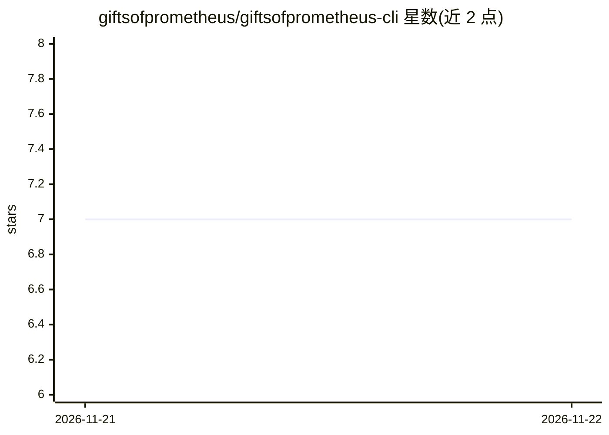

# giftsofprometheus/giftsofprometheus-cli

⭐ 7 · TypeScript · Apache-2.0 · 推送 2026-11-21 · [GitHub](https://github.com/giftsofprometheus/giftsofprometheus-cli) · [官网](https://giftsofprometheus.com/?utm_source=github&utm_medium=repo&utm_campaign=cli) · 组织维护

**俄语 AI 知识目录 CLI：供开发者与其 AI 代理检索大会演讲转录**

将 AI 大会演讲目录（含俄语标题、TL;DR、时间戳章节、演讲者简介、完整转录）开放给终端和 AI 代理：代理可按用户任务检索演讲、读取转录并保存收藏至网站账户。npm 全局安装，需 Node.js 22.12+；`ask`/转录/收藏/推荐等命令需免费账户，`talks search`/`list`/`get` 无需账户。仓库附带 agent skill，可通过 npx skills、Claude Code 插件或 AGENTS.md 安装；CLI 每日检查更新并比对已安装的 skill 副本哈希。目录代码为 Apache-2.0，目录内容归平台与演讲作者所有。

## 筛选速览

| 维度 | 判定 | 备注 |
|---|---|---|
| AI 角色 | `ai-knowledge` | 知识聚合/清单类 |
| 许可风险 | `permissive` | Apache-2.0 |
| 部署形态 | `library` | 以包/库形式分发 |
| 模型依赖 | — | README 未给出锁定关系 |
| 硬件要求 | — | 无带数字的原话,不猜 |
| 安装摩擦 | `low` | 无编译、无系统依赖或容器化 |
| 成熟度 | — | 结构信号不足 |

## 能力要点

- 供终端与 Claude Code/Codex/Cursor 使用的 AI 演讲目录访问接口
- 附带 agent skill，可通过 npx skills 或 Claude Code 插件安装
- 使用 --json 输出以便代理调用，遇到 502/503/504 错误自动重试两次
- skill 副本每日哈希检查，使用 doctor/update 命令管理

## 适用场景

- 让代理根据我当前任务推荐相关的 AI 大会演讲
- 直接在终端搜索并阅读演讲的俄语转录，无需观看视频
- 在网站账户和代理之间同步收藏与兴趣

## 场景标签

 · 领域:AI 知识聚合/开发者工具

## 证据(README 行号)

> L5: **Дары Прометея** — мировые знания об ИИ на русском: доклады о разработке с AI-агентами, RAG, evals, MCP и AI-продук
> L7: Этот CLI открывает каталог для терминала и AI-агентов: Claude Code, Codex, Cursor и других. Агент сам подберёт докла
> L86: **Конференции:** AI Engineer World's Fair 2026, AI Engineer World's Fair 2025, AI Engineer Europe 2026, Agentic Dev

## 星数曲线

2026-11-21 7 → 2026-11-22 7（+0）

---
*卡片 v1 · prompt 1.4 · 生成 2026-11-21 · 置信度 high · 依据 README sha `268f1ee0eb5f` · [字段定义](../../DATASET.md)*
