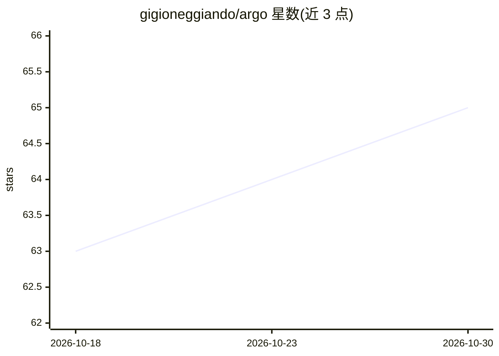

# gigioneggiando/argo

⭐ 65 · Python · Apache-2.0 · 推送 2026-10-28 · [GitHub](https://github.com/gigioneggiando/argo) · [官网](https://gigioneggiando.com/argo/) · 个人维护

**面向开发者的 LLM 驱动静态漏洞检测工具，产出可复核漏洞报告**

Argo 是一个以 LLM 为分析引擎的静态代码安全审计（SAST）工具：指向本地文件夹或仓库，先提取代码应持有的安全不变量，再分阶段审计，由第二个模型尝试反驳每条发现，最终输出可复核的漏洞报告。支持两种模式：通用代码审计（默认，无需 brief）与漏洞赏金分诊（需传入项目 brief 与链接文件）。后端可选 Claude Code、Codex、Gemini 或本地模型（Ollama/LM Studio 的 Qwen、DeepSeek）。工具声明为概率性而非穷尽，检测默认只读、不自动提交、默认不接触线上主机；运行时验证与 live 验证均为可选且需授权门控。仓库另披露了在多个开源项目上的公开审计结果。

## 筛选速览

| 维度 | 判定 | 备注 |
|---|---|---|
| AI 角色 | `ai-native` | 本体是模型或模型工具 |
| 许可风险 | `permissive` | Apache-2.0 |
| 部署形态 | `None` |  |
| 模型依赖 | local-ok | 支持本地模型 |
| 硬件要求 | — | 无带数字的原话,不猜 |
| 安装摩擦 | `low` | 无编译、无系统依赖或容器化 |
| 成熟度 | — | 结构信号不足 |

## 能力要点

- 多阶段审计流水线：先提取安全不变量，再审计并用第二模型反驳每条发现
- 通用审计与漏洞赏金分诊两种模式，同一引擎
- 多后端支持：Claude Code/Codex/Gemini 或本地开源模型（Ollama/LM Studio）
- 默认只读、不自动提交、不接触线上主机；live 验证需显式授权参数

## 适用场景

- 对自己的本地或私有代码库做安全审计
- 在授权的漏洞赏金项目内做范围过滤后的分诊与提交草稿生成
- CTF 或安全研究中用 LLM 复核源码逻辑与授权类缺陷

## 场景标签

`代码审查` · 领域:编码与开发

## 证据(README 行号)

> L52: Argo finds security vulnerabilities in **source code** by driving an LLM as the analyst — it reads
> L55: vulnerability report. It runs **for free** if you point it at a local model (Ollama, LM Studio)
> L78: - **Multi-backend, including fully free** — Claude Code, Codex, Gemini, or a **local open-source

## 星数曲线

2026-10-18 63 → 2026-10-30 65（+2）

---
*卡片 v1 · prompt 1.4 · 生成 2026-10-24 · 置信度 high · 依据 README sha `dca981a5de34` · [字段定义](../../DATASET.md)*
