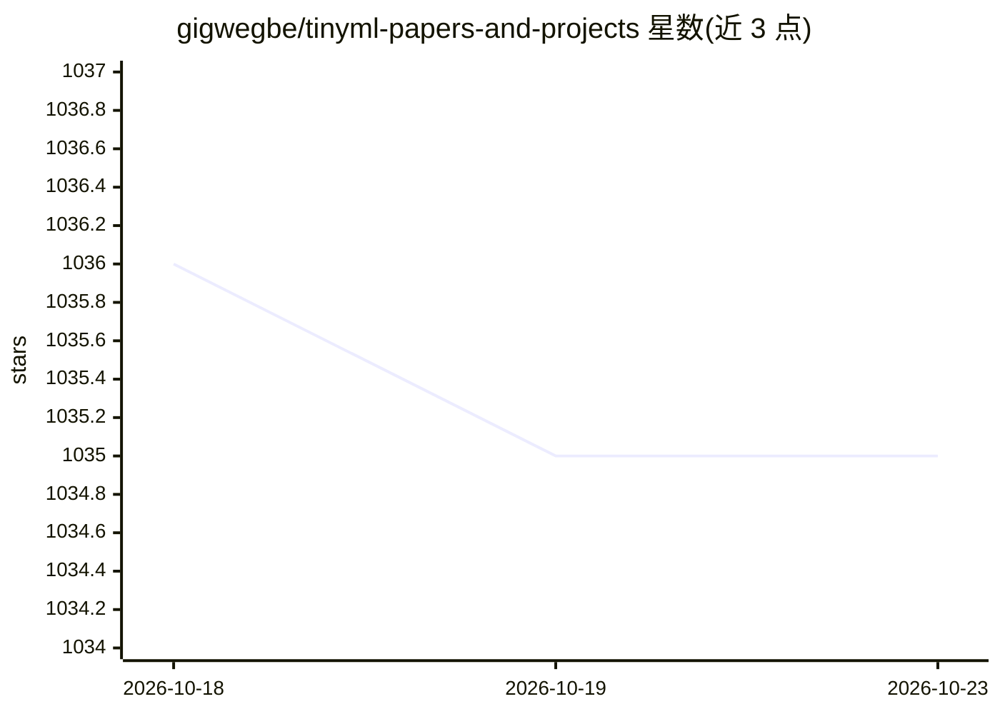

# gigwegbe/tinyml-papers-and-projects

⭐ 1,035 · MIT · 推送 2025-12-08 · [GitHub](https://github.com/gigwegbe/tinyml-papers-and-projects) · 个人维护

**TinyML 论文与项目精选清单：面向嵌入式机器学习研究者**

TinyML 领域的策展清单：按年份（2016-2025）收录论文条目，覆盖模型压缩、量化、神经架构搜索、唤醒词检测、边缘推理等方向；每条附论文 PDF 链接，部分条目附官方代码、演示视频或博客链接。另设项目源码、项目文章、基准测试与资源等分节。面向需要在微控制器等资源受限设备上部署机器学习的研究者与开发者，用于检索文献与对应实现。

## 筛选速览

| 维度 | 判定 | 备注 |
|---|---|---|
| AI 角色 | `ai-knowledge` | 知识聚合/清单类 |
| 许可风险 | `permissive` | MIT |
| 部署形态 | `None` |  |
| 模型依赖 | — | README 未给出锁定关系 |
| 硬件要求 | — | 无带数字的原话,不猜 |
| 安装摩擦 | `low` | 无编译、无系统依赖或容器化 |
| 成熟度 | — | 结构信号不足 |

## 能力要点

- 按年份组织的论文条目，多数附 arXiv PDF 链接
- 部分条目附官方代码仓库、演示视频与博客
- 覆盖模型压缩、量化、NAS、唤醒词、边缘推理等方向
- 含基准测试与资源分节

## 适用场景

- 查找 TinyML 领域某年度的代表性论文
- 根据论文条目定位对应的官方开源实现
- 了解资源受限设备上机器学习的研究方向分布

## 场景标签

`精选清单` `科研工具` · 领域:学习与行业

## 证据(README 行号)

> L7: This is a list of interesting papers, projects, articles and talks about TinyML.
> L10: - Awesome Projects: Projects Source code | Projects Articles

## 星数曲线

2026-10-18 1,036 → 2026-10-23 1,035（-1）

---
*卡片 v1 · prompt 1.4 · 生成 2026-10-21 · 置信度 high · 依据 README sha `ba500b054cef` · [字段定义](../../DATASET.md)*
