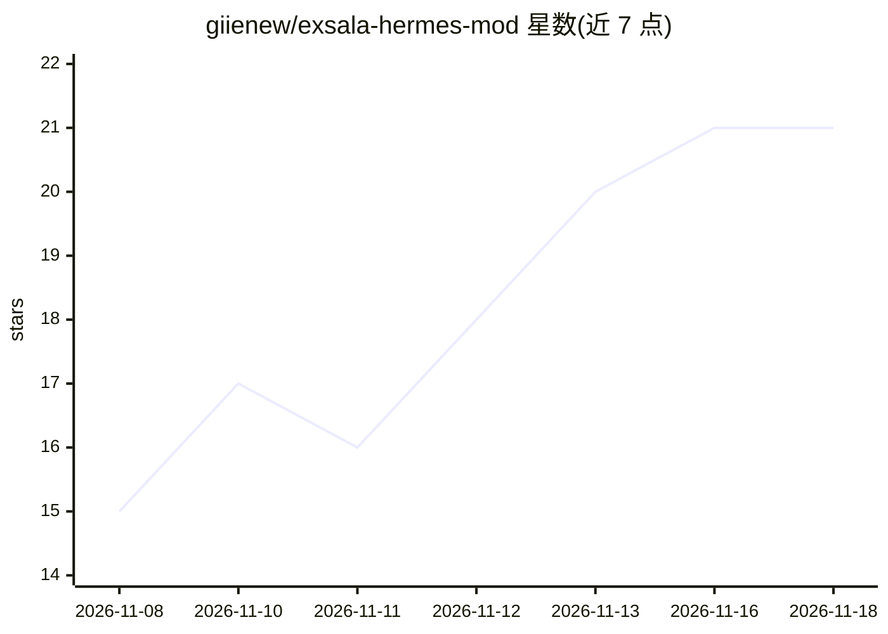

# giienew/exsala-hermes-mod

⭐ 21 · Python · 推送 2026-11-05 · [GitHub](https://github.com/giienew/exsala-hermes-mod) · 个人维护

**面向 Hermes Agent 的免确认执行配置与 172 技能包**

为 Hermes Agent（Nous Research 的开源 AI agent）提供的配置档与技能集合安装器：通过 bash 脚本替换系统提示词、关闭确认提示（approvals.mode=off）与本地内容门控（tirith_enabled=false），并合并安装 172 个技能到 ~/.hermes/skills/。安装前自动备份 config.yaml，可用单行命令回滚；不修改模型 provider、API key、路由与 .env 等设置。要求 Linux VPS/服务器上的 Hermes Agent ≥0.22，附 bash/python3/curl。模型无关，README 列出 DeepSeek/GLM/Qwen/MiMo 等。MIT 许可。

## 筛选速览

| 维度 | 判定 | 备注 |
|---|---|---|
| AI 角色 | `ai-ecosystem` | LLM/agent 周边工具 |
| 许可风险 | `none` | — |
| 部署形态 | `None` |  |
| 模型依赖 | — | README 未给出锁定关系 |
| 硬件要求 | — | 无带数字的原话,不猜 |
| 安装摩擦 | `low` | 无编译、无系统依赖或容器化 |
| 成熟度 | — | 结构信号不足 |

## 能力要点

- 关闭确认提示与本地内容门控的执行配置档
- 合并安装 172 个技能（自动化/Web/安全研究/媒体等）
- 安装前自动备份，单行命令回滚，幂等可重复运行
- 模型无关，不改动 provider、API key 与 .env

## 适用场景

- 让自己的 Hermes 实例以少确认、直接执行的方式工作
- 批量获取自动化与安全研究等技能扩展 agent 能力
- 为本地/服务器部署的 Hermes 做可回滚的配置切换

## 场景标签

 · 领域:AI agent 配置/技能分发

## 证据(README 行号)

> L8: EXSALA HERMES MOD is a **configuration profile + skill collection** for Hermes Agent (the open-source AI agent by No
> L45: |`approvals.mode` (+ `*_mode`)|`off`|No confirmation prompts|

## 星数曲线

2026-11-08 15 → 2026-11-18 21（+6）

---
*卡片 v1 · prompt 1.4 · 生成 2026-11-18 · 置信度 high · 依据 README sha `1e5d51f93226` · [字段定义](../../DATASET.md)*
