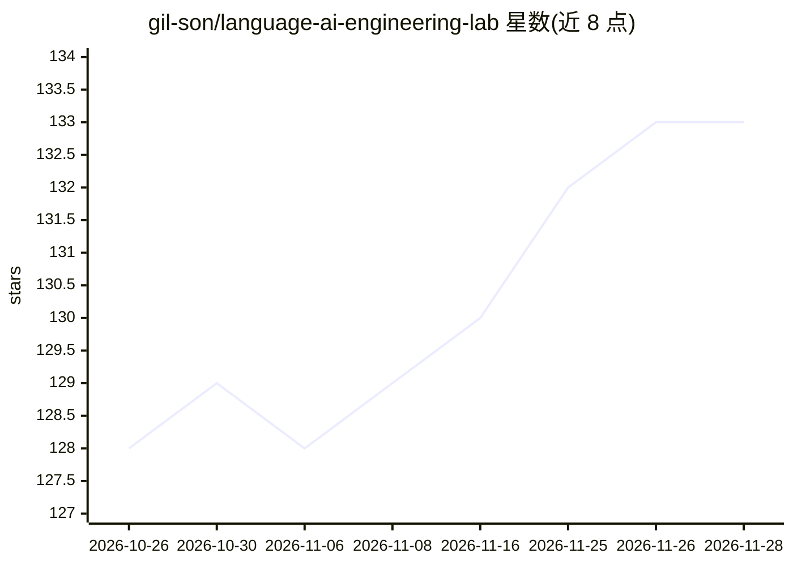

# gil-son/language-ai-engineering-lab

⭐ 133 · Jupyter Notebook · GPL-3.0 · 推送 2026-11-20 · [GitHub](https://github.com/gil-son/language-ai-engineering-lab) · 个人维护

**语言 AI 工程学习路径仓库：从 NLP 基础到生产系统**

一个结构化教学仓库，按 17 个编号章节组织学习路径，覆盖 NLP/NLU/NLG 基础、Transformer 架构、LLM 原理与微调、提示工程、上下文管理、RAG 流水线、评测基准、幻觉处理、MCP、编排框架（LangChain/LangGraph 等）、Agent 系统、多模态、MLOps 与数据工程。内容形式包括代码与 notebook 示例、图示、参考链接与策展视频，并附实战项目目录。面向从入门到构建生产级语言 AI 应用的学习者，无产品安装或运行说明。

## 筛选速览

| 维度 | 判定 | 备注 |
|---|---|---|
| AI 角色 | `ai-knowledge` | 知识聚合/清单类 |
| 许可风险 | `viral` | GPL-3.0 |
| 部署形态 | `None` |  |
| 模型依赖 | — | README 未给出锁定关系 |
| 硬件要求 | — | 无带数字的原话,不猜 |
| 安装摩擦 | `low` | 无编译、无系统依赖或容器化 |
| 成熟度 | — | 结构信号不足 |

## 能力要点

- 17 个编号章节覆盖语言 AI 工程全生命周期
- 含 RAG、上下文工程、评测、MCP、Agent 等专题
- 提供代码/notebook 示例、项目与渐进式学习路径

## 适用场景

- 系统学习从 NLP 到 LLM 应用工程的完整知识体系
- 查找 RAG、评测、Agent 等专题的实现示例与 notebook
- 按仓库给出的渐进路径规划语言 AI 学习计划

## 场景标签

`教程课程` · 领域:学习与行业

## 证据(README 行号)

> L3: Welcome to the **Language AI Engineering Lab** — a comprehensive, structured repository designed to guide you from *
> L23: ### 01-Human-Language-and-NLP
> L192: The repository is organized into numbered folders to reflect a progressive learning path:

## 星数曲线

2026-10-26 128 → 2026-11-28 133（+5）

---
*卡片 v1 · prompt 1.4 · 生成 2026-11-28 · 置信度 high · 依据 README sha `fc2b841fe29c` · [字段定义](../../DATASET.md)*
