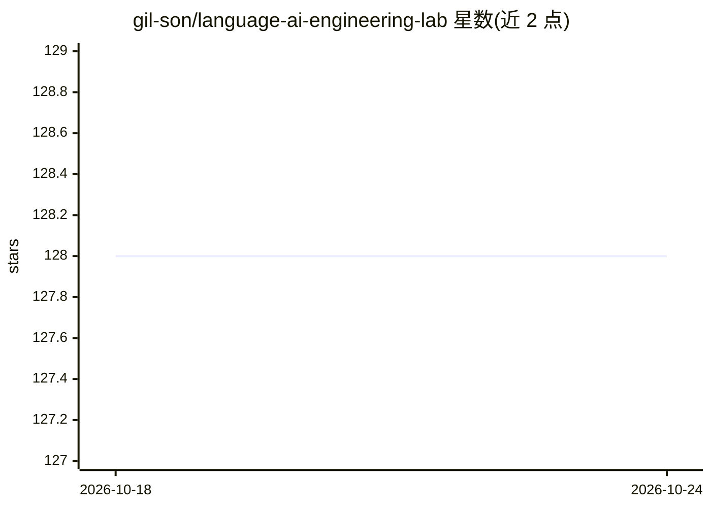

# gil-son/language-ai-engineering-lab

⭐ 128 · Jupyter Notebook · GPL-3.0 · 推送 2026-06-24 · [GitHub](https://github.com/gil-son/language-ai-engineering-lab) · 个人维护

**覆盖 NLP 到 LLM 生产系统的结构化学习路径仓库**

由个人维护的语言 AI 工程学习仓库：以 17 个编号章节组织从 NLP 基础、Transformer 架构、LLM 训练到 RAG、上下文工程、评测、MCP、编排、Agent、多模态与 MLOps 的渐进式学习路径，另含项目、Jupyter notebook 与工具脚本。内容形式为概念讲解、图示、代码示例与参考文献，覆盖从零基础到生产级系统的完整生命周期。定位为教程/知识聚合仓库，不提供可安装的产品。

## 筛选速览

| 维度 | 判定 | 备注 |
|---|---|---|
| AI 角色 | `ai-knowledge` | 知识聚合/清单类 |
| 许可风险 | `viral` | GPL-3.0 |
| 部署形态 | `None` |  |
| 模型依赖 | — | README 未给出锁定关系 |
| 硬件要求 | — | 无带数字的原话,不猜 |
| 安装摩擦 | `low` | 无编译、无系统依赖或容器化 |
| 成熟度 | — | 结构信号不足 |

## 能力要点

- 17 个编号章节覆盖 NLP→LLM→RAG→Agent→MLOps 全周期
- 含学习目标清单与推荐渐进式学习路径
- 提供项目、Jupyter notebook 与工具脚本目录

## 适用场景

- 系统学习从 NLP 基础到 LLM 生产部署的工程知识
- 按章节查找 RAG、上下文工程、评测等专题的学习材料
- 跟随实践项目与 notebook 做动手练习

## 场景标签

`教程课程` `精选清单` · 领域:学习与行业

## 证据(README 行号)

> L3: Welcome to the **Language AI Engineering Lab** — a comprehensive, structured repository designed to guide you from *
> L15: In this repository, you will explore **in-depth concepts of Generative AI**, including **diagrams, illustrations, c
> L19: ## Repository Summary

## 星数曲线

2026-10-18 128 → 2026-10-24 128（+0）

---
*卡片 v1 · prompt 1.4 · 生成 2026-10-22 · 置信度 high · 依据 README sha `7a878b6da054` · [字段定义](../../DATASET.md)*
