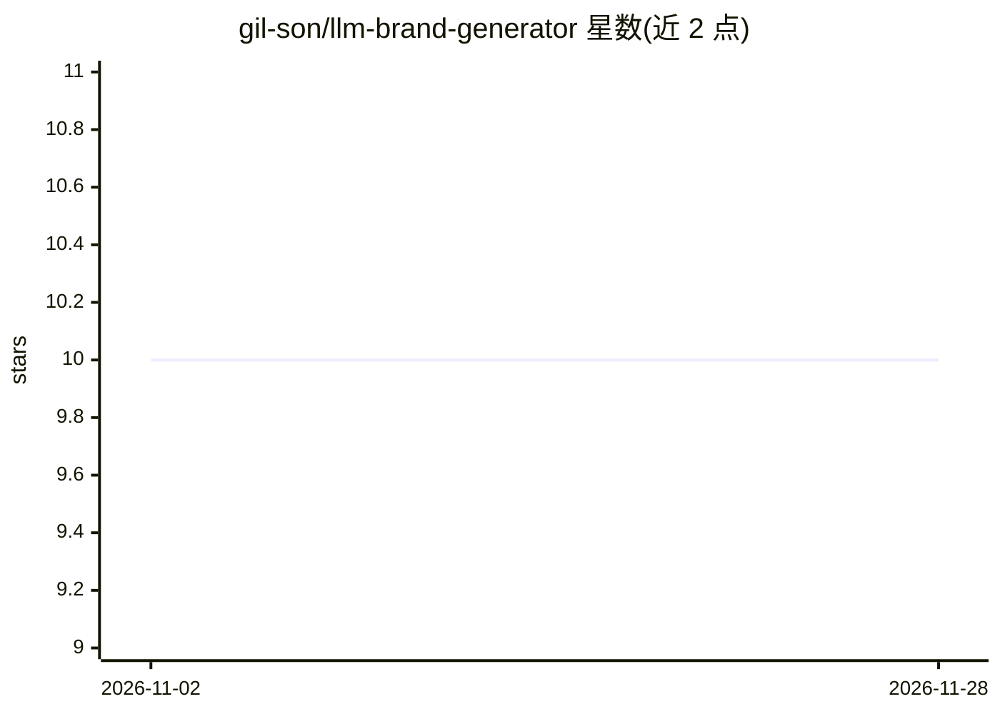

# gil-son/llm-brand-generator

⭐ 10 · Python · MIT · 推送 2026-11-02 · [GitHub](https://github.com/gil-son/llm-brand-generator) · 个人维护

**面向创业者/设计者的 AI 品牌生成助手：输入描述产出名称、口号与视觉方案**

基于 Streamlit 界面的品牌生成工具：用户输入业务描述后，通过 LangChain 加载 docs/ 目录参考文档并以 FAISS 构建向量检索，将上下文连同描述发送至本地 Ollama 运行的 llama3.2 模型，输出品牌名、口号、logo 创意、配色与品牌概念；logo 图片由 Pollinations.ai 生成，配色取自 ColorMagic。运行前提是本机安装 Ollama，logo 生成目前为占位实现，整个流程约一分钟。

## 筛选速览

| 维度 | 判定 | 备注 |
|---|---|---|
| AI 角色 | `ai-native` | 本体是模型或模型工具 |
| 许可风险 | `permissive` | MIT |
| 部署形态 | `library` | 以包/库形式分发 |
| 模型依赖 | local-ok | 支持本地模型 |
| 硬件要求 | — | 无带数字的原话,不猜 |
| 安装摩擦 | `low` | 无编译、无系统依赖或容器化 |
| 成熟度 | — | 结构信号不足 |

## 能力要点

- 本地 LLM（Ollama + llama3.2）与云 API 组合生成品牌建议
- FAISS 向量检索参考文档作为生成上下文（RAG）
- 输出品牌名、口号、logo 创意、配色与品牌概念五类结果
- Streamlit 网页界面，一键生成

## 适用场景

- 为新业务快速获得品牌命名与口号建议
- 生成品牌概念与配色方案作为设计起点
- 在本地运行 LLM 生成品牌文案而不依赖云端文本服务

## 场景标签

`AI 写作` `RAG` `图像生成` · 领域:内容生成

## 证据(README 行号)

> L3: An AI-powered branding assistant that generates **brand name, slogan, and concept visuals** from a simple descriptio
> L27:  - The Python code (via `langchain-community`) connects to Ollama’s local server (default: `http://localhost:11434`
> L36:  - You describe your business/idea in the Streamlit interface.

## 星数曲线

2026-11-02 10 → 2026-11-28 10（+0）

---
*卡片 v1 · prompt 1.4 · 生成 2026-11-19 · 置信度 high · 依据 README sha `e6192ad7dce1` · [字段定义](../../DATASET.md)*
