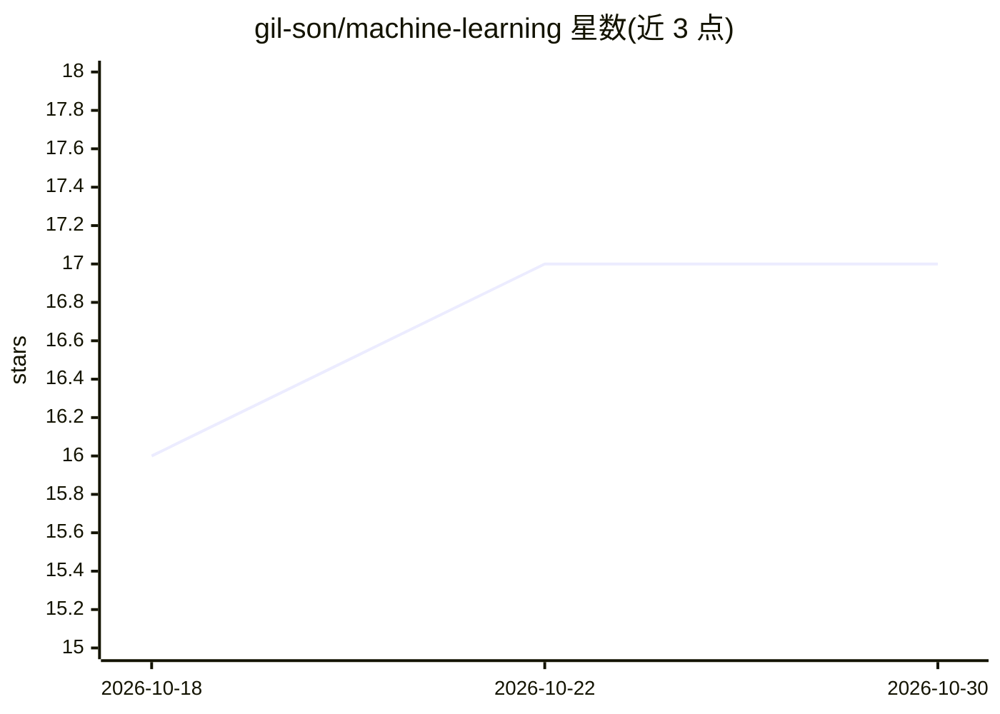

# gil-son/machine-learning

⭐ 17 · Jupyter Notebook · 推送 2026-09-15 · [GitHub](https://github.com/gil-son/machine-learning) · 个人维护

**面向初学者到从业者的机器学习理论算法学习指南仓库**

机器学习学习指南仓库：以结构化讲解配合数学公式与 Mermaid 图，覆盖监督/无监督/半监督/强化学习四大范式的核心算法（线性回归、逻辑回归、决策树、随机森林、SVM、kNN、k-Means、PCA 等），并整理数值/类别/时间序列/文本/图像/表格等数据类型与任务、评估指标的对应关系，及模型生命周期各阶段说明。README 提及可用 Jupyter Notebook 交互实验，并列出 scikit-learn、TensorFlow、PyTorch 等相关库，但本页未给出安装命令或运行入口。适合入门者系统了解 ML 概念与算法原理。

## 筛选速览

| 维度 | 判定 | 备注 |
|---|---|---|
| AI 角色 | `ai-knowledge` | 知识聚合/清单类 |
| 许可风险 | `none` | — |
| 部署形态 | `None` |  |
| 模型依赖 | — | README 未给出锁定关系 |
| 硬件要求 | — | 无带数字的原话,不猜 |
| 安装摩擦 | `low` | 无编译、无系统依赖或容器化 |
| 成熟度 | — | 结构信号不足 |

## 能力要点

- 按四大学习范式组织算法讲解并附数学公式（MSE、基尼系数、SVM 边际等）
- 数据类型→任务→评估指标的对照表与 Mermaid 图解
- 覆盖分类、回归、聚类、异常检测、降维、推荐等任务定义与模型生命周期

## 适用场景

- 系统学习机器学习基础概念与核心算法原理
- 查数据类型与任务、评估指标的对应关系
- 了解模型从问题定义到部署的生命周期步骤

## 场景标签

`教程课程` · 领域:学习与行业

## 证据(README 行号)

> L3: This repository is a comprehensive guide to Machine Learning, designed to bridge theoretical concepts with practical
> L6: - Demystify Machine Learning through structured explanations and illustrative examples
> L8: - Enable experimentation with interactive Jupyter Notebooks for real-world learning

## 星数曲线

2026-10-18 16 → 2026-10-30 17（+1）

---
*卡片 v1 · prompt 1.4 · 生成 2026-10-29 · 置信度 high · 依据 README sha `dec063d276a4` · [字段定义](../../DATASET.md)*
