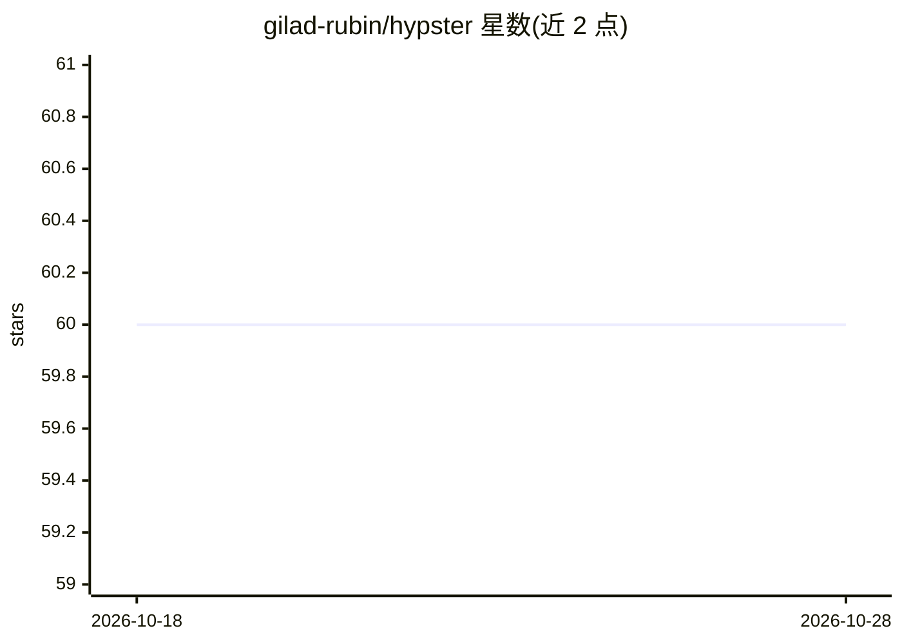

# gilad-rubin/hypster

⭐ 60 · Python · MIT · 推送 2026-10-08 · [GitHub](https://github.com/gilad-rubin/hypster) · [官网](https://gilad-rubin.gitbook.io/hypster) · 个人维护

**面向 AI/ML 工作流的 Python 配置与超参优化框架**

Python 配置管理库，用于定义和实例化 AI/ML 工作流的配置：支持层级与条件化配置、类型安全校验，内置 Optuna 超参优化支持，可导出 JSON 可序列化的配置 schema。另提供 WHEN/THEN 规则即配置、可选 notebook 可视化 UI（viz 扩展），并发布面向 agent 的文档（llms.txt 与 Markdown 全量导出）。设计参考 Meta 的 hydra/hydra-zen 与 Optuna 的 define-by-run API。通过 uv/pip 安装，MIT 许可。

## 筛选速览

| 维度 | 判定 | 备注 |
|---|---|---|
| AI 角色 | `ai-ecosystem` | LLM/agent 周边工具 |
| 许可风险 | `permissive` | MIT |
| 部署形态 | `library` | 以包/库形式分发 |
| 模型依赖 | — | README 未给出锁定关系 |
| 硬件要求 | — | 无带数字的原话,不猜 |
| 安装摩擦 | `low` | 无编译、无系统依赖或容器化 |
| 成熟度 | — | 结构信号不足 |

## 能力要点

- 层级、条件化与可替换的配置定义
- 原生集成 Optuna 超参优化
- explore 检查条件分支并导出 JSON schema
- 发布 AI 可读文档（llms.txt / llms-full.txt）

## 适用场景

- 管理带条件分支的机器学习实验配置
- 结合 Optuna 做超参数优化
- 以 WHEN/THEN 规则列表定义可重放的配置规则

## 场景标签

 · 领域:机器学习工具链/配置管理

## 证据(README 行号)

> L21:  Hypster is a lightweight configuration framework for managing and optimizing AI & ML workflows
> L28: - 🧪 **Hyperparameter Optimization Built-In**: Native, first-class optuna support

## 星数曲线

2026-10-18 60 → 2026-10-28 60（+0）

---
*卡片 v1 · prompt 1.4 · 生成 2026-10-24 · 置信度 high · 依据 README sha `8c217542d1e9` · [字段定义](../../DATASET.md)*
