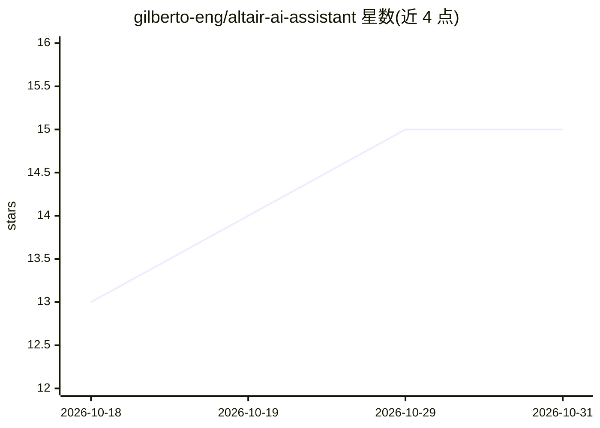

# gilberto-eng/altair-ai-assistant

⭐ 15 · Python · 推送 2026-08-01 · [GitHub](https://github.com/gilberto-eng/altair-ai-assistant) · 个人维护

**带语音交互与自动化工具的开源 AI 桌面助手**

葡萄牙语维护的开源个人 AI 助手：通过 Whisper 听写、Piper/ElevenLabs 语音回复，提供桌面实时聊天、WhatsApp Web 自动化（发消息/音频/文件）、操作系统自动化（开应用、执行命令、网页搜索）、FastAPI 远程控制接口，以及 CAD/3D 文件生成、方程/积分/物理仿真计算、本地文档提取与摘要等工具。LLM 与语音模型可经界面配置，LLM 经 Groq API key 接入。以 Python 源码运行（requirements.txt + python run_altair.py），WhatsApp 部分依赖 Node 脚本。

## 筛选速览

| 维度 | 判定 | 备注 |
|---|---|---|
| AI 角色 | `ai-native` | 本体是模型或模型工具 |
| 许可风险 | `none` | — |
| 部署形态 | `library` | 以包/库形式分发 |
| 模型依赖 | — | README 未给出锁定关系 |
| 硬件要求 | — | 无带数字的原话,不猜 |
| 安装摩擦 | `low` | 无编译、无系统依赖或容器化 |
| 成熟度 | — | 结构信号不足 |

## 能力要点

- Whisper 语音输入 + Piper/ElevenLabs TTS 回复
- WhatsApp Web 自动化（音频转 ogg 管线、消息与文件发送）
- 自然语言生成 3D/CAD 文件（齿轮、几何体、机械系统）
- FastAPI 远程 API，可用移动设备控制

## 适用场景

- 用语音与桌面 AI 助手对话并让其操作系统和开应用
- 自动化收发 WhatsApp 消息、音频与文件
- 用自然语言生成 3D 零件或做数学/物理计算
- 通过手机远程控制本机助手

## 场景标签

`AI 助手` `语音 Agent` `GUI 自动化` · 领域:效率与自动化

## 证据(README 行号)

> L3: Altair é um assistente de inteligência artificial open-source que combina interação por voz, automação do computador
> L7: - Interacao por voz: escuta via Whisper, responde por TTS (Piper/ElevenLabs) e permite ligar/desligar fala na UI.

## 星数曲线

2026-10-18 13 → 2026-10-31 15（+2）

---
*卡片 v1 · prompt 1.4 · 生成 2026-10-31 · 置信度 mid · 依据 README sha `b09021c844ba` · [字段定义](../../DATASET.md)*
