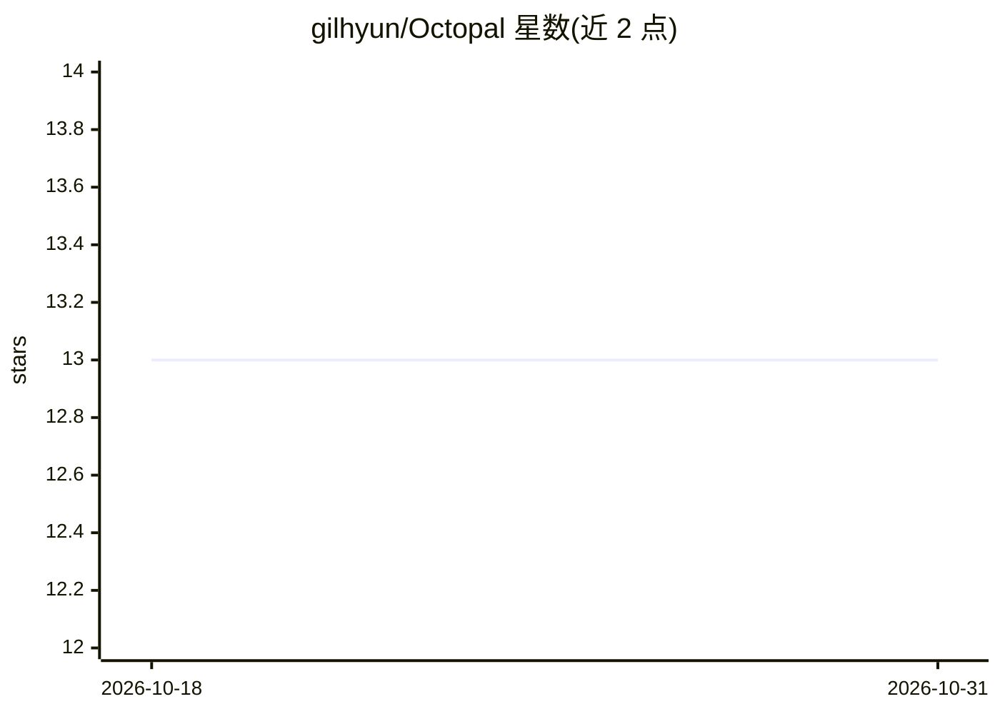

# gilhyun/Octopal

⭐ 13 · Rust · MIT · 推送 2026-10-23 · [GitHub](https://github.com/gilhyun/Octopal) · [官网](https://octopal.app) · 个人维护 · 中文 README

**多模型 AI agent 编排桌面应用：Claude/GPT/Ollama 协同群聊**

基于 Tauri 2 的桌面应用，将 Claude、GPT 与 Ollama agent 汇入同一工作区群聊，可按角色指派不同模型，由隐藏编排器读上下文调度 agent，支持 @mention 路由与 agent 间互相召唤。底层经 goose 的 Agent Control Protocol 接入各 provider，亦支持 API key 直连。agent 数据以 octopal-agents/ 子文件夹（config.json + prompt.md）本地存储，含工作区 wiki、细粒度权限控制（文件写入/Shell/网络/路径白名单）。提供 macOS/Windows 安装包，Linux 需从源码构建，且依赖 Secret Service keyring 守护进程。

## 筛选速览

| 维度 | 判定 | 备注 |
|---|---|---|
| AI 角色 | `ai-ecosystem` | LLM/agent 周边工具 |
| 许可风险 | `permissive` | MIT |
| 部署形态 | `desktop` | 安装包/桌面程序 |
| 模型依赖 | local-ok | 支持本地模型 |
| 硬件要求 | — | 无带数字的原话,不猜 |
| 安装摩擦 | `low` | 无编译、无系统依赖或容器化 |
| 成熟度 | — | 结构信号不足 |

## 能力要点

- 群聊界面运行多 provider agent，按角色指派模型
- 基于 goose ACP 路由，支持 Ollama 等本地模型离线运行
- 细粒度权限控制（文件写入、Shell 执行、网络、allowPaths/denyPaths）
- agent 以本地文件夹（config.json + prompt.md）定义，无云无账号

## 适用场景

- 让不同模型的 agent 在同一群里协作完成编码、审阅、起草等任务
- 按角色混搭云端模型与本地 Ollama 模型
- 在本地管理工作区共享知识库（wiki）与多 agent 团队

## 场景标签

`多智能体` `知识库管理` · 领域:Agent 开发

## 证据(README 行号)

> L20: Octopal is a **multi-model AI agent orchestrator** with a group chat interface. Run Claude, GPT, and Ollama agents 
> L22: Built on **goose**, an open-source framework that routes each agent to the right provider through the Agent Control

## 星数曲线

2026-10-18 13 → 2026-10-31 13（+0）

---
*卡片 v1 · prompt 1.4 · 生成 2026-10-31 · 置信度 high · 依据 README sha `42a31f17be48` · [字段定义](../../DATASET.md)*
