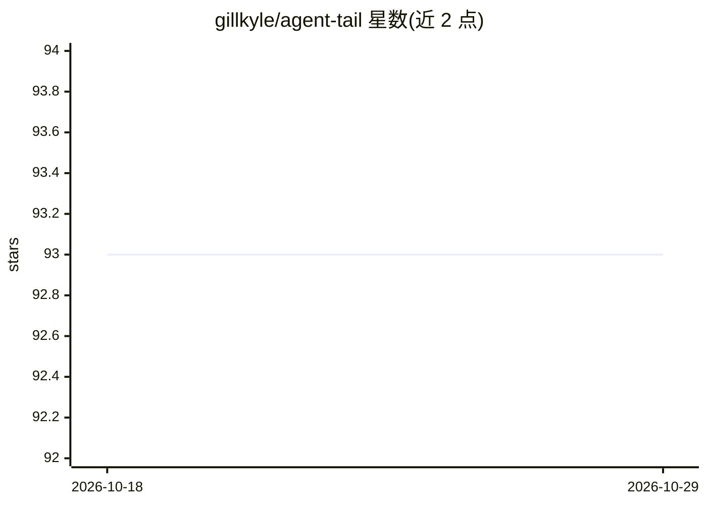

# gillkyle/agent-tail

⭐ 93 · TypeScript · MIT · 推送 2026-03-11 · [GitHub](https://github.com/gillkyle/agent-tail) · [官网](https://agent-tail.vercel.app/) · 个人维护

**把开发服务器与浏览器日志聚合到文件，供 AI 编程代理读取**

CLI 工具与框架插件组合：用 agent-tail run 包装任意开发命令，捕获 stdout/stderr 写入按会话组织的纯文本日志文件（latest 符号链接指向最新会话）；Vite/Next.js 插件通过注入脚本捕获浏览器 console 输出、未捕获错误与 Promise 拒绝。日志带时间戳、级别、来源位置与堆栈，支持内容过滤（--exclude）与服务静音（--mute），可聚合多服务到同一会话目录，适配 monorepo（Turborepo/Nx/Lerna）。面向使用 Claude Code、Cursor、Amp 等 AI 编程工具的开发者，代理通过 grep/tail 读取日志文件获取确切错误信息。

## 筛选速览

| 维度 | 判定 | 备注 |
|---|---|---|
| AI 角色 | `ai-enhanced` | 去掉 AI 部分产品仍成立 |
| 许可风险 | `permissive` | MIT |
| 部署形态 | `library` | 以包/库形式分发 |
| 模型依赖 | — | README 未给出锁定关系 |
| 硬件要求 | — | 无带数字的原话,不猜 |
| 安装摩擦 | `low` | 无编译、无系统依赖或容器化 |
| 成熟度 | — | 结构信号不足 |

## 能力要点

- CLI 包装任意命令捕获服务端 stdout/stderr，与语言/框架无关
- Vite/Next.js 插件捕获浏览器 console、未捕获错误与 Promise 拒绝
- 会话目录 + latest 符号链接，默认保留 10 个会话并自动清理
- --exclude 内容过滤与 --mute 服务静音，monorepo 共享会话支持

## 适用场景

- 让 AI 编程代理直接 grep 日志文件定位运行时错误，替代复制粘贴描述
- 前后端多服务开发时把日志聚合到一处统一查看
- 捕获浏览器端静默报错（未捕获错误/Promise 拒绝）供调试

## 场景标签

 · 领域:开发者工具/日志

## 证据(README 行号)

> L3: Pipe dev server and browser console logs to log files on your machine that AI coding agents like Claude Code, Amp, a
> L365: ## How agents use it

## 星数曲线

2026-10-18 93 → 2026-10-29 93（+0）

---
*卡片 v1 · prompt 1.4 · 生成 2026-10-23 · 置信度 high · 依据 README sha `2bfccab90a6f` · [字段定义](../../DATASET.md)*
