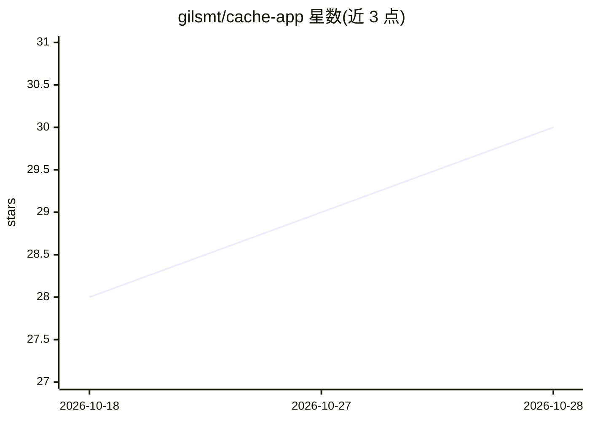

# gilsmt/cache-app

⭐ 30 · TypeScript · Apache-2.0 · 推送 2026-10-27 · [GitHub](https://github.com/gilsmt/cache-app) · [官网](https://www.cachd.app) · 个人维护

**个人 AI 书签管理器：跨平台收藏、聚合与检索**

自托管或云端使用的个人书签管理应用：将浏览器、Instagram、TikTok、YouTube、X、GitHub 等平台的收藏内容集中到一处，保存数量无上限。AI 能力包括 Smart Collections 按相关性排序、每集合一行摘要、跨库问答的 AI agent 搜索，以及每日摘要/每周提醒等自定义自动化。技术栈为 Next.js + Bun + PostgreSQL + Prisma，支持 Vercel 一键部署，需配置 Gemini/OpenRouter/AI Gateway 的 API key。另暴露 MCP 端点供 Claude、Cursor 等 agent 读写书签库。功能仍在演进中。

## 筛选速览

| 维度 | 判定 | 备注 |
|---|---|---|
| AI 角色 | `ai-enhanced` | 去掉 AI 部分产品仍成立 |
| 许可风险 | `permissive` | Apache-2.0 |
| 部署形态 | `None` |  |
| 模型依赖 | locked-api |  |
| 硬件要求 | — | 无带数字的原话,不猜 |
| 安装摩擦 | `low` | 无编译、无系统依赖或容器化 |
| 成熟度 | `idea` | |

## 能力要点

- 聚合多平台收藏内容到统一库，保存数量无上限
- AI agent 跨全部收藏内容进行搜索问答
- Smart Collections 用 AI 按相关性排序并随偏好调整
- 暴露 MCP server 供 Codex/Claude/Cursor 等 agent 直接读写书签库

## 适用场景

- 把散落在各平台的收藏集中管理并随时检索
- 通过 AI 对话在已保存内容中找回答案
- 自托管掌握数据，配合 AI 生成每日摘要与提醒

## 场景标签

`知识库管理` · 领域:知识与检索

## 证据(README 行号)

> L22: - Smart Collections uses AI to rank saved items by relevance and adapt to your preferences over time.
> L25: - Simply ask the Cache AI agent and search across all your saved content.
> L97: Cache App exposes an MCP server so AI agents like Codex, Claude, Cursor, and others can read and write your library

## 星数曲线

2026-10-18 28 → 2026-10-28 30（+2）

---
*卡片 v1 · prompt 1.4 · 生成 2026-10-26 · 置信度 high · 依据 README sha `483634d1e025` · [字段定义](../../DATASET.md)*
