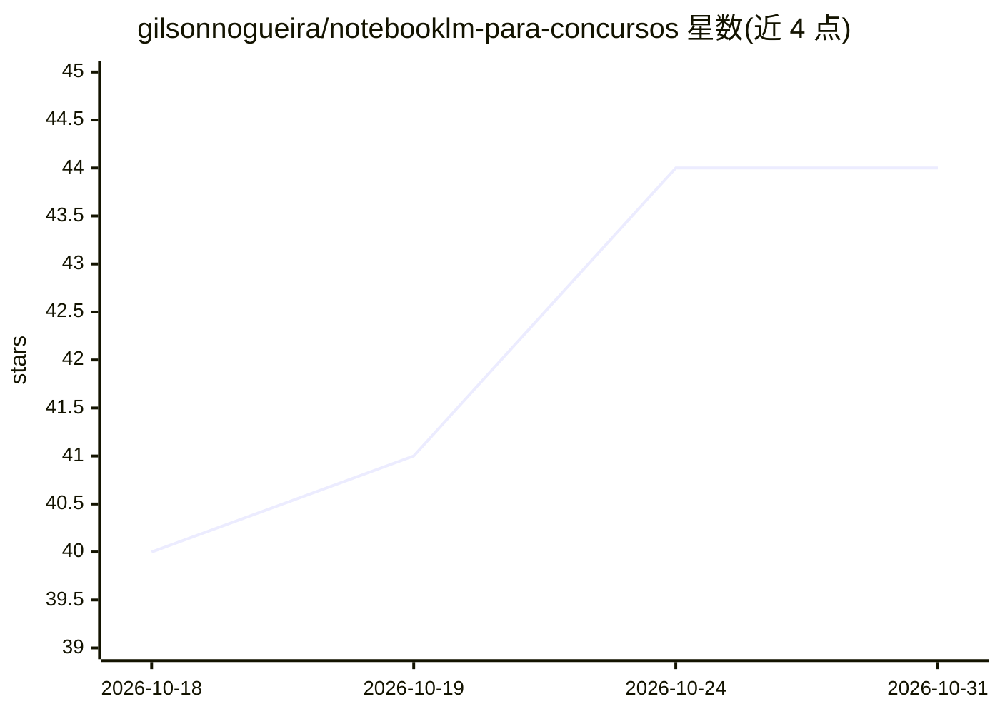

# gilsonnogueira/notebooklm-para-concursos

⭐ 44 · MIT · 推送 2026-10-11 · [GitHub](https://github.com/gilsonnogueira/notebooklm-para-concursos) · 个人维护

**面向巴西公考考生的 AI 学习方法论：19 个提示词+NotebookLM/Gemini**

一套开放的公考学习工程方法论（N.A.G.），由系统提示词、19 个校准提示词（P01-P19）、按学科构建的 book-to-skill 技能模板和分步操作指南组成。使用方式是考生将自己合法获取的课程 PDF/视频转录上传到 Google NotebookLM，把仓库文件作为 Sources 加载，通过 90 分钟学习周期（Método MIT）执行 Pareto 拆解、费曼反向审计、盲做题等流程，并以 Anki 间隔重复巩固。核心机制是封闭来源的 source-grounded 记忆以规避通用模型的幻觉问题；无需编程，脚本自动化仅为可选高级模式。

## 筛选速览

| 维度 | 判定 | 备注 |
|---|---|---|
| AI 角色 | `ai-knowledge` | 知识聚合/清单类 |
| 许可风险 | `permissive` | MIT |
| 部署形态 | `None` |  |
| 模型依赖 | — | README 未给出锁定关系 |
| 硬件要求 | — | 无带数字的原话,不猜 |
| 安装摩擦 | `medium` | 含编译或系统依赖之一 |
| 成熟度 | — | 结构信号不足 |

## 能力要点

- 19 个校准提示词（P01-P19）+ SYSTEM_PROMPT + 学科 Skill 模板
- book-to-skill 模式：将教材转换为带 DNA、cheatsheet、真题 patterns 的技能
- 90 分钟超日节律学习周期（Método MIT）与 Anki 间隔重复整合
- 三级使用模式：纯浏览器手动 / AI 辅助 / 个人脚本自动化

## 适用场景

- 用 NotebookLM 基于自己课程的 PDF 做结构化知识拆解
- 按 90 分钟周期执行抗遗忘的高强度学习会话
- 统计命题机构（Cebraspe/FGV/FCC）的考点分布与陷阱

## 场景标签

`提示工程` `教程课程` · 领域:Agent 开发

## 证据(README 行号)

> L43: 1. **Abra o NotebookLM:** Acesse notebooklm.google.com e crie um caderno para a sua disciplina (ex: `Direito Tribut
> L48:  * Os prompts que você vai usar (ex: `prompts/PROMPT_P01_DetalharAula.md`, `PROMPT_P16_FeynmanReverso.md`, `PROMPT_
> L95: O N.A.G. ancora todo o aprendizado em um **universo estritamente fechado de fontes reais (*source-grounded memory*)

## 星数曲线

2026-10-18 40 → 2026-10-31 44（+4）

---
*卡片 v1 · prompt 1.4 · 生成 2026-10-25 · 置信度 high · 依据 README sha `8f52f687ddba` · [字段定义](../../DATASET.md)*
