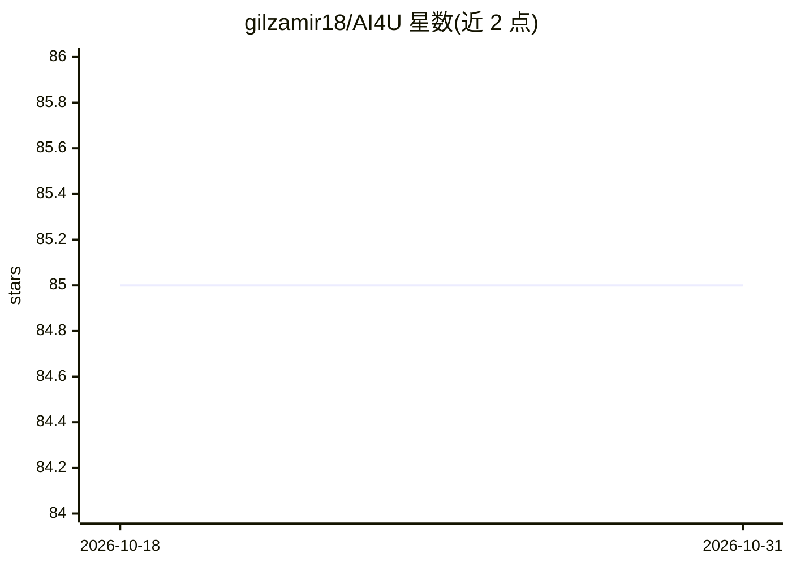

# gilzamir18/AI4U

⭐ 85 · C# · MIT · 推送 2026-04-13 · [GitHub](https://github.com/gilzamir18/AI4U) · 组织维护

**Godot 游戏引擎的强化学习智能体建模插件**

面向 Godot 游戏引擎（.NET 版）的智能体框架：通过传感器、执行器、事件、奖励函数与大脑组件的抽象来构建 NPC 或 AI 实验环境，以 Python 与 C# 脚本两部分提供。Python 侧经 pip 安装，可与 Stable-Baselines3、PyTorch 集成（ai4u-ml 包），C# 侧将 addons/ai4u 复制进 Godot 项目并支持 ONNX 模型运行。要求 Godot 4.2.2–4.5、Python 3.12、Gymnasium。主要给游戏开发与强化学习实验用户使用。

## 筛选速览

| 维度 | 判定 | 备注 |
|---|---|---|
| AI 角色 | `ai-ecosystem` | LLM/agent 周边工具 |
| 许可风险 | `permissive` | MIT |
| 部署形态 | `library` | 以包/库形式分发 |
| 模型依赖 | — | README 未给出锁定关系 |
| 硬件要求 | `gpu-8g` | |
| 安装摩擦 | `medium` | 含编译或系统依赖之一 |
| 成熟度 | `idea` | |

## 能力要点

- 传感器/执行器/事件/奖励函数/大脑的智能体抽象
- 与 Stable-Baselines3 和 PyTorch 的集成包 ai4u-ml
- C# 侧支持 ONNX 模型（Microsoft.ML.OnnxRuntime）
- 兼容 Gymnasium 接口

## 适用场景

- 在 Godot 游戏中用强化学习构建 NPC 行为
- 把游戏场景搭成 AI/强化学习实验环境
- 导出 ONNX 模型在 Godot 内运行训练好的智能体

## 场景标签

`强化学习` `Agent 框架` · 领域:Agent 开发

## 证据(README 行号)

> L3: Welcome to **AI4U**, an agent framework for modeling virtual reality and game environments. This repository contains
> L5: AI4U leverages Godot's architecture to simplify agent specification through an agent abstraction. It provides an alt
> L30: ### Integration with Stable-Baselines and PyTorch

## 星数曲线

2026-10-18 85 → 2026-10-31 85（+0）

---
*卡片 v1 · prompt 1.4 · 生成 2026-10-24 · 置信度 high · 依据 README sha `c48acf9a67f0` · [字段定义](../../DATASET.md)*
