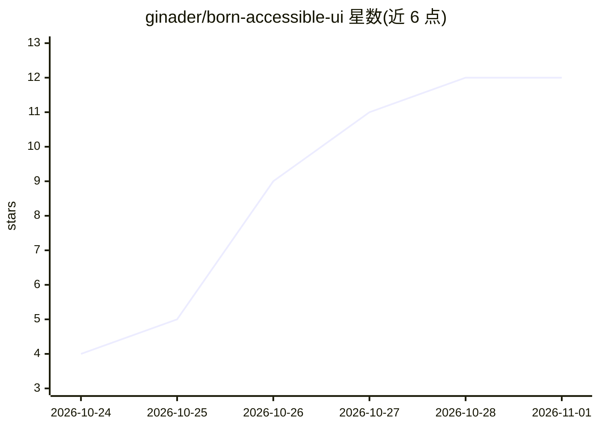

# ginader/born-accessible-ui

⭐ 12 · JavaScript · Apache-2.0 · 推送 2026-10-25 · [GitHub](https://github.com/ginader/born-accessible-ui) · 个人维护

**让 AI 编码代理一次成稿生成无障碍前端的技能包与校验工具**

a11yTO Conf 2026 演讲的配套工具包：以 Agent Skill（SKILL.md）形式提供三套协议，指导 Claude Code、GitHub Copilot、Gemini CLI、Cursor 等编码代理按 Plan→Build→Verify→Fix→Report 流程构建可访问 UI。附带 audit.mjs（Playwright + axe-core 运行时审计，含隐藏状态与 320px 回流检查）与 lint.mjs（重算颜色对比声明、标记可点击 div）两个脚本，审计结果生成 fix-prompt.md 供代理修复。通过 git clone 或下载 ZIP 放入项目，npm 安装审计依赖，需 Node.js 18+ 与 Chrome/Chromium。限制：自动检查零违规不等于 WCAG 合规，仍需手动键盘与读屏检查。

## 筛选速览

| 维度 | 判定 | 备注 |
|---|---|---|
| AI 角色 | `ai-ecosystem` | LLM/agent 周边工具 |
| 许可风险 | `permissive` | Apache-2.0 |
| 部署形态 | `library` | 以包/库形式分发 |
| 模型依赖 | — | README 未给出锁定关系 |
| 硬件要求 | — | 无带数字的原话,不猜 |
| 安装摩擦 | `low` | 无编译、无系统依赖或容器化 |
| 成熟度 | — | 结构信号不足 |

## 能力要点

- Agent Skill 格式协议：规划地标/标题/控件/对比度后再生成标记
- audit.mjs 以 Playwright + axe-core 审计初始视图与隐藏状态及 320px 回流
- lint.mjs 重算对比度注释声明并标记可点击 div，无依赖
- 审计输出 fix-prompt.md 供代理最多 3 轮修复，可作 CI 门禁

## 适用场景

- 让我的编码代理在生成 UI 时自带上可访问性规划与校验
- 在 CI 中用 lint/audit 脚本拦截无障碍违规
- 修复遗留页面的对比度、地标与标签问题

## 场景标签

`编码 Agent` · 领域:编码与开发

## 证据(README 行号)

> L11: Drop this folder into your project and point your coding agent (Claude Code, GitHub Copilot, Gemini CLI, Codex, Cur
> L100: |`born-accessible-ui/`|The Agent Skill (agentskills.io format). This one folder holds the whole workflow.|
> L104: |`born-accessible-ui/scripts/audit.mjs`|Runtime audit with Playwright + axe-core.|

## 星数曲线

2026-10-24 4 → 2026-11-01 12（+8）

---
*卡片 v1 · prompt 1.4 · 生成 2026-11-01 · 置信度 high · 依据 README sha `fd375edc2040` · [字段定义](../../DATASET.md)*
