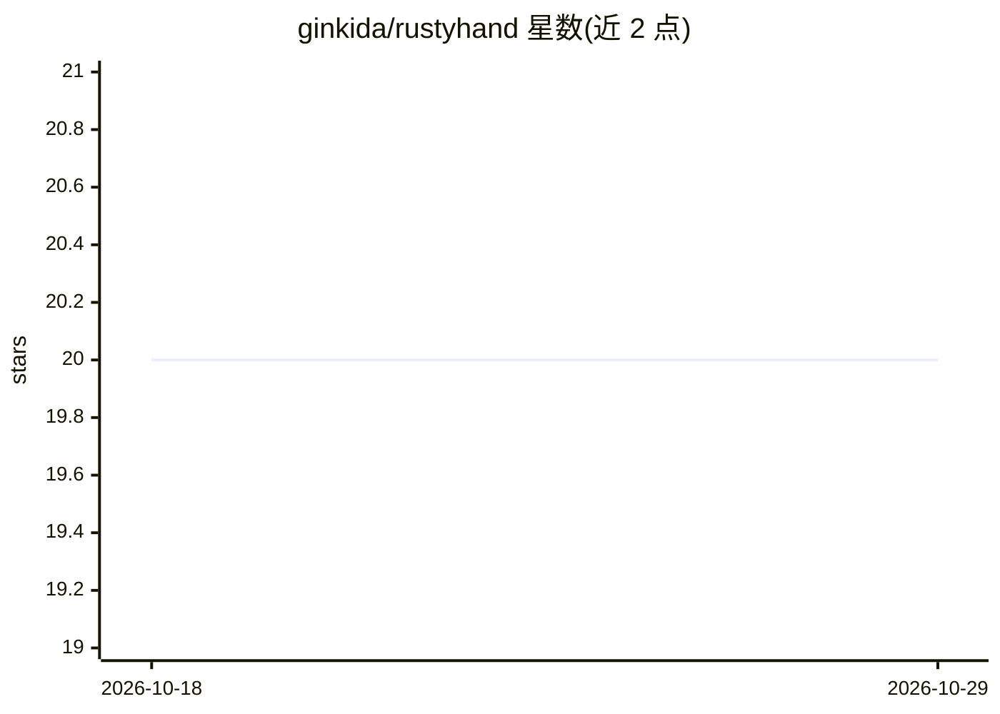

# ginkida/rustyhand

⭐ 20 · Rust · MIT · 推送 2026-09-08 · [GitHub](https://github.com/ginkida/rustyhand) · 个人维护

**Rust 单二进制的自主 Agent 操作系统，Telegram 优先**

用 Rust 编写的开源 Agent 操作系统（基于 OpenFang 修改扩展），编译为约 32MB 单一二进制，内含内核调度、37 个 agent、26 个 LLM 提供商接入、37 个消息通道（Telegram/Discord/Slack 等）、MCP server、A2A 协议、120+ API 端点与 React Web 仪表盘。Agent 支持 72 个内置工具（shell、搜索、浏览器自动化、RAG、知识图谱）、定时自主运行并推送结果到 Telegram。无 API key 时回退到确定性 mock 驱动的演示模式。提供安装脚本、Docker 与源码构建三种安装方式。

## 筛选速览

| 维度 | 判定 | 备注 |
|---|---|---|
| AI 角色 | `ai-ecosystem` | LLM/agent 周边工具 |
| 许可风险 | `permissive` | MIT |
| 部署形态 | `desktop` | 安装包/桌面程序 |
| 模型依赖 | local-ok | 支持本地模型 |
| 硬件要求 | — | 无带数字的原话,不猜 |
| 安装摩擦 | `low` | 无编译、无系统依赖或容器化 |
| 成熟度 | — | 结构信号不足 |

## 能力要点

- 单一约 32MB 二进制，含内核调度、工作流与 72 个内置工具
- 26 个 LLM 提供商环境变量自动检测，支持 MCP server 与 A2A 协议
- Telegram 为主通道：图片描述、Whisper 语音转录、审批按钮、自主推送结果
- 无 API key 时回退确定性 mock 驱动并预置四个示例资源

## 适用场景

- 搭建 7×24 小时自主运行的 Telegram 个人 agent
- 通过 Web 仪表盘或 CLI 管理 agent、工作流、定时任务与通道
- 在多平台渠道（Telegram/Discord/Slack 等）接入统一的 agent 服务

## 场景标签

`Agent 框架` `多智能体` `工作流自动化` · 领域:Agent 开发

## 证据(README 行号)

> L61: RustyHand is an **open-source Agent Operating System** — not a chatbot framework, not a Python wrapper around an LL
> L7:  One binary. Autonomous Telegram agent. Agents that actually work for you.

## 星数曲线

2026-10-18 20 → 2026-10-29 20（+0）

---
*卡片 v1 · prompt 1.4 · 生成 2026-10-28 · 置信度 mid · 依据 README sha `3ccde7b63acb` · [字段定义](../../DATASET.md)*
