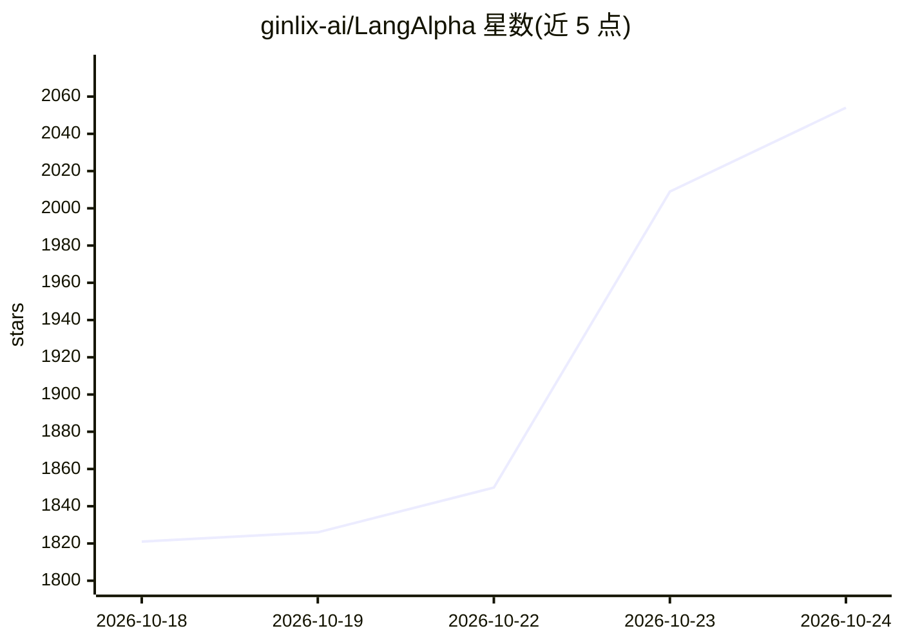

# ginlix-ai/LangAlpha

⭐ 2,077 · Python · Apache-2.0 · 推送 2026-10-24 · [GitHub](https://github.com/ginlix-ai/LangAlpha) · [官网](https://langalpha.ai) · 组织维护 · 中文 README

**面向个人投资者的 AI agent 交易与研究工作台**

LangAlpha 是开源的 agentic trading harness：多 agent 并行做投研（读财报、拉行情、跑代码）、按论题（thesis）持久化 workspace、定时/价格触发自动化盯盘、生成 DCF 工作簿/PDF 报告/交互仪表盘，并在用户授权边界内接入券商账户下单。支持 Robinhood、盈透、moomoo、Webull 四家券商，订单走统一受控路径，宿主端强制权限。可托管（beta）或 Docker 自托管，提供浏览器/桌面端及 Slack 等渠道；自托管行情为延迟数据，无期权与实盘触发。

## 筛选速览

| 维度 | 判定 | 备注 |
|---|---|---|
| AI 角色 | `ai-native` | 本体是模型或模型工具 |
| 许可风险 | `permissive` | Apache-2.0 |
| 部署形态 | `None` |  |
| 模型依赖 | local-ok | 支持本地模型 |
| 硬件要求 | — | 无带数字的原话,不猜 |
| 安装摩擦 | `low` | 无编译、无系统依赖或容器化 |
| 成熟度 | `idea` | |

## 能力要点

- 多 agent 并行研究 + 按论题持久化的 workspace 与自动化盯盘
- 在宿主端强制执行的权限与订单治理路径，覆盖 4 家券商
- 产出带公式的 Excel 模型、PDF/HTML 报告与交互仪表盘
- 支持任意模型：订阅登录、API key 或本地模型自托管

## 适用场景

- 让 AI agent 做投资研究并生成卖方式 initiation 报告
- 按价格/日程自动化盯盘，结果推送到 Slack/Telegram 等渠道
- 在受控权限下让 agent 通过自己的券商账户下单

## 场景标签

`金融量化` `多智能体` · 领域:Agent 开发

## 证据(README 行号)

> L5:  Open-source AI agents that research the market, build the thesis,
> L42: Ask a question and LangAlpha splits it across parallel analysts that read filings, pull prices, options and macro d
> L106: We are committed to making LangAlpha the best harness for agentic trading. Brokers now let AI agents trade real ac

## 星数曲线

2026-10-18 1,821 → 2026-10-24 2,054（+233）

---
*卡片 v1 · prompt 1.4 · 生成 2026-10-21 · 置信度 high · 依据 README sha `8b3957df26fb` · [字段定义](../../DATASET.md)*
