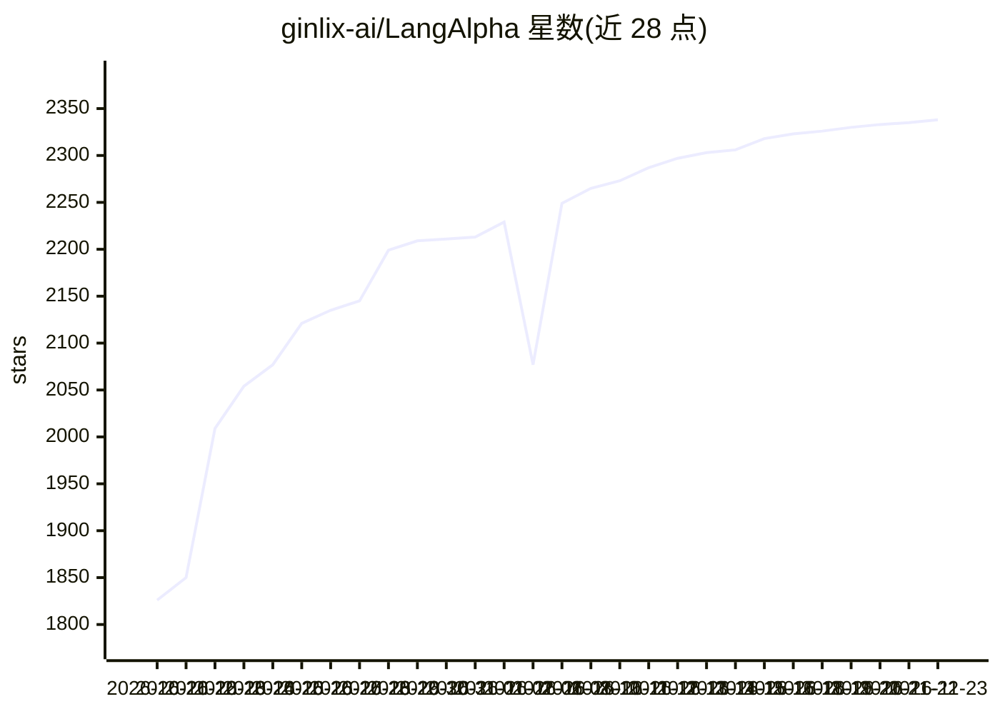

# ginlix-ai/LangAlpha

⭐ 2,338 · Python · Apache-2.0 · 推送 2026-11-22 · [GitHub](https://github.com/ginlix-ai/LangAlpha) · [官网](https://langalpha.ai) · 组织维护 · 中文 README

**为投资者提供研究市场并按权限执行交易的 AI agent 工作台**

自称 agentic trading 的 harness：以 workspace 持久化研究主线，agent 团队并行读财报、拉取价格与宏观数据并运行代码分析，产出 Excel 模型、PDF/HTML 报告、幻灯片与交互式仪表盘；支持定时简报与价格触发的自动化监控，结果可推送至 Slack/Discord/Telegram/飞书/iMessage。交易侧将下单收敛到宿主端强制执行的单一受控路径，支持从只读到实盘的权限分级，当前接入 Robinhood、Interactive Brokers、moomoo、Webull 四家券商。可通过 Docker 自托管，也提供托管版与桌面应用。

## 筛选速览

| 维度 | 判定 | 备注 |
|---|---|---|
| AI 角色 | `ai-native` | 本体是模型或模型工具 |
| 许可风险 | `permissive` | Apache-2.0 |
| 部署形态 | `library` | 以包/库形式分发 |
| 模型依赖 | local-ok | 支持本地模型 |
| 硬件要求 | — | 无带数字的原话,不猜 |
| 安装摩擦 | `low` | 无编译、无系统依赖或容器化 |
| 成熟度 | `idea` | |

## 能力要点

- 多 agent 并行研究，任务中可追加指令改向
- workspace 持久化文件、对话与 agent 笔记，跨会话累积
- 宿主端强制执行的订单权限与一次性审批路径
- Sources 面板逐轮列出 agent 触碰的文件、数据调用与来源

## 适用场景

- 围绕一个研究主题让 agent 团队读财报并生成 DCF 模型与报告
- 设置价格触发或每周检查，让 agent 持续跟踪持仓
- 连接券商账户，在只读/模拟/实盘权限下让 agent 下单

## 场景标签

`多智能体` `金融量化` `工作流自动化` · 领域:Agent 开发

## 证据(README 行号)

> L3:  The harness for agentic trading.
> L44: Ask a question and LangAlpha splits it across parallel analysts that read filings, pull prices, options and macro d
> L110: - **Limits that hold whatever the model does.** What each connection may do, which orders wait for your approval, 

## 星数曲线

2026-10-21 1,826 → 2026-11-23 2,338（+512）

---
*卡片 v1 · prompt 1.4 · 生成 2026-11-23 · 置信度 mid · 依据 README sha `359152adbd12` · [字段定义](../../DATASET.md)*
