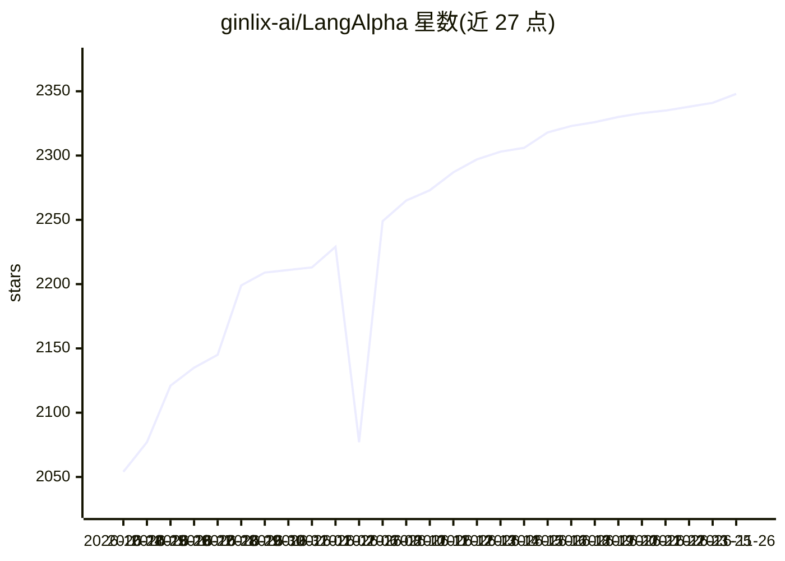

# ginlix-ai/LangAlpha

⭐ 2,348 · Python · Apache-2.0 · 推送 2026-11-25 · [GitHub](https://github.com/ginlix-ai/LangAlpha) · [官网](https://langalpha.ai) · 组织维护 · 中文 README

**面向投资者的 agentic 交易 harness：研究、建论点、按权限下单**

为投资研究构建的 agent harness：提出问题后拆分给并行分析师子 agent，读取财报、拉取价格与宏观数据并运行代码计算；每个论点对应一个持久化工作区，文件、对话与 agent 笔记跨会话留存。支持定时简报、价格触发的自动化监控，产出 Excel 模型、PDF/HTML 报告与交互式仪表盘；每笔订单经宿主机强制执行的权限与审批路径到达券商账户，接入 Robinhood、Interactive Brokers、moomoo、Webull 四家券商。以桌面应用（macOS/Linux/Windows）或 Docker 自托管方式提供，要求 Python 3.13+。

## 筛选速览

| 维度 | 判定 | 备注 |
|---|---|---|
| AI 角色 | `ai-native` | 本体是模型或模型工具 |
| 许可风险 | `permissive` | Apache-2.0 |
| 部署形态 | `library` | 以包/库形式分发 |
| 模型依赖 | — | README 未给出锁定关系 |
| 硬件要求 | — | 无带数字的原话,不猜 |
| 安装摩擦 | `low` | 无编译、无系统依赖或容器化 |
| 成熟度 | — | 结构信号不足 |

## 能力要点

- 并行分析师子 agent 拆分问题并读取财报、期权与宏观数据
- 持久化工作区：文件、对话与 agent 笔记跨会话留存
- 定时简报与价格触发的自动化监控，结果可投递到 Slack/Discord/Telegram/飞书/iMessage
- 订单经宿主机强制执行的单一受管路径，权限不随模型改变

## 适用场景

- 让一组 agent 分工研究一家公司并生成 initiate-coverage 报告
- 按设定的价格阈值与财报时间自动唤醒 agent 复查论点
- 连接自己的券商账户，在只读到实盘下单的权限范围内让 agent 交易
- 从既有研究生成带实时公式的 Excel 模型和交互式仪表盘

## 场景标签

`金融量化` · 领域:学习与行业

## 证据(README 行号)

> L3:  The harness for agentic trading.
> L5:  Open-source AI agents that research the market, build the thesis,
> L133: **Use the model you already pay for.** Sign in with a Claude or ChatGPT subscription, use a coding plan from Kimi,

## 星数曲线

2026-10-24 2,054 → 2026-11-26 2,348（+294）

---
*卡片 v1 · prompt 1.4 · 生成 2026-11-25 · 置信度 mid · 依据 README sha `2f3cbbed1338` · [字段定义](../../DATASET.md)*
