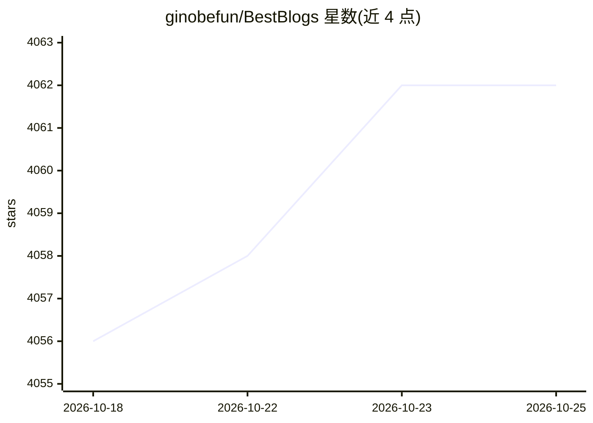

# ginobefun/BestBlogs

⭐ 4,065 · TypeScript · 推送 2026-07-08 · [GitHub](https://github.com/ginobefun/BestBlogs) · [官网](https://bestblogs.dev) · 个人维护 · 中文 README

**面向读者的 AI 内容筛选与阅读助手，汇集高质量技术文章**

BestBlogs.dev 是 AI 驱动的私人阅读产品：以 RSS 爬取 + AI 深度分析（六维评分、摘要、关键观点）形成公共质量池，通过每日早报、精选周刊、主题解读与内容广场对外分发；登录用户可管理 RSS/Newsletter/Twitter/YouTube/Podcast 五种源，使用 AI 伴读、沉浸式翻译与个性化推荐，Free/Pro 分层。同时向开发者开放 OpenAPI v2、npm CLI 与 Claude Code/Codex/Cursor 的 Agent Skills，仓库还整理发布 551 个 OPML 订阅源。限制：核心为在线服务，需注册使用，Pro 功能付费。

## 筛选速览

| 维度 | 判定 | 备注 |
|---|---|---|
| AI 角色 | `ai-native` | 本体是模型或模型工具 |
| 许可风险 | `none` | — |
| 部署形态 | `library` | 以包/库形式分发 |
| 模型依赖 | — | README 未给出锁定关系 |
| 硬件要求 | — | 无带数字的原话,不猜 |
| 安装摩擦 | `low` | 无编译、无系统依赖或容器化 |
| 成熟度 | — | 结构信号不足 |

## 能力要点

- AI 六维评分（选题/内容/深度/实用/创新/表达）+ 摘要 + 关键观点的内容分析流水线
- 支持 RSS/Newsletter/Twitter/YouTube/Podcast 五种源的统一管理与中英沉浸式翻译
- 开放 OpenAPI v2、CLI（MIT 源码）与 25 个 Agent Skills 原语
- 仓库发布 551 个 OPML 订阅源（公众号/播客/YouTube）

## 适用场景

- 用 AI 初筛和评分解决订阅源信息过载，只读高分内容
- 跨语言阅读英文一手技术内容并获得 AI 伴读
- 让 Claude Code/Codex 等 Agent 直接查询值得读的内容并收藏笔记

## 场景标签

`AI 助手` `精选清单` · 领域:对话与助手

## 证据(README 行号)

> L4: > 发现真正适合你的高质量内容 —— BestBlogs 是 AI 驱动的私人阅读助手。
> L66: |**AI 内容分析**|六维评分（选题 / 内容 / 深度 / 实用 / 创新 / 表达）+ 摘要 + 关键观点 + 金句|

## 星数曲线

2026-10-18 4,056 → 2026-10-25 4,062（+6）

---
*卡片 v1 · prompt 1.4 · 生成 2026-10-21 · 置信度 high · 依据 README sha `edfc274f7792` · [字段定义](../../DATASET.md)*
