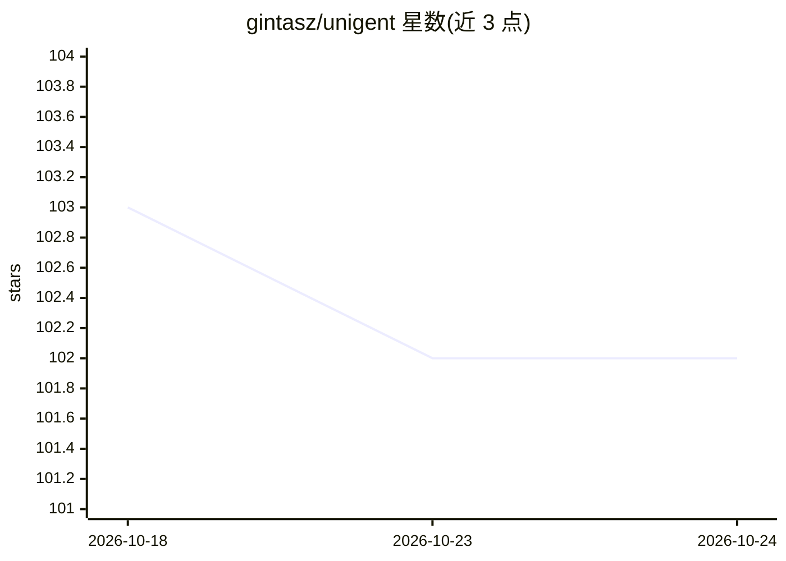

# gintasz/unigent

⭐ 102 · TypeScript · MIT · 推送 2026-10-13 · [GitHub](https://github.com/gintasz/unigent) · 个人维护

**TypeScript 跨 CLI 的有状态 agent 工作流 SDK**

面向 TypeScript 开发者的 agent 编排 SDK：在 Pi SDK、Claude Code、Codex CLI 三种已安装的 agent CLI 之上提供统一 API，后端可一行切换。控制流、分支、并行留在 TypeScript 中，模型仅处理模糊任务。运行通过保留完成工具返回 Zod/Standard Schema 类型化输出，而非从文本抓取；支持会话保持与 fork 分支、scope 预算与截止时间、checkpoint 复用已完成工作、完整 trace 与 TUI 实时运行树检查器。要求 Node.js 24+ 与至少一个已认证 harness，TUI 需另装 Bun；包为 ESM-only。

## 筛选速览

| 维度 | 判定 | 备注 |
|---|---|---|
| AI 角色 | `ai-ecosystem` | LLM/agent 周边工具 |
| 许可风险 | `permissive` | MIT |
| 部署形态 | `library` | 以包/库形式分发 |
| 模型依赖 | locked-api |  |
| 硬件要求 | — | 无带数字的原话,不猜 |
| 安装摩擦 | `low` | 无编译、无系统依赖或容器化 |
| 成熟度 | — | 结构信号不足 |

## 能力要点

- 统一 API 覆盖 Pi / Claude Code / Codex CLI，后端一行切换
- 类型化结构化输出经保留完成工具返回，不由文本抓取
- 会话 fork 并行复用上下文，checkpoint 避免重复计费
- unigent tui 实时渲染运行树、工具调用、用量与成本

## 适用场景

- 在既有 agent CLI 之上编写可测试的有状态工作流
- 需要类型化结构化输出而非解析自然语言回复
- 多 agent 并行协作并复用同一会话上下文
- 通过 TUI 实时检查与重跑 agent 工作流

## 场景标签

`Agent 框架` `多智能体` · 领域:Agent 开发

## 证据(README 行号)

> L5:  The cross-harness agent SDK for TypeScript.
> L22: own API, its own session model, and no way to get a typed value back. Unigent puts one TypeScript
> L25: - **🔀 One API, every harness.** Write your workflow once against Pi, Claude Code, or Codex CLI.

## 星数曲线

2026-10-18 103 → 2026-10-24 102（-1）

---
*卡片 v1 · prompt 1.4 · 生成 2026-10-23 · 置信度 high · 依据 README sha `8d3d2f1fcb10` · [字段定义](../../DATASET.md)*
