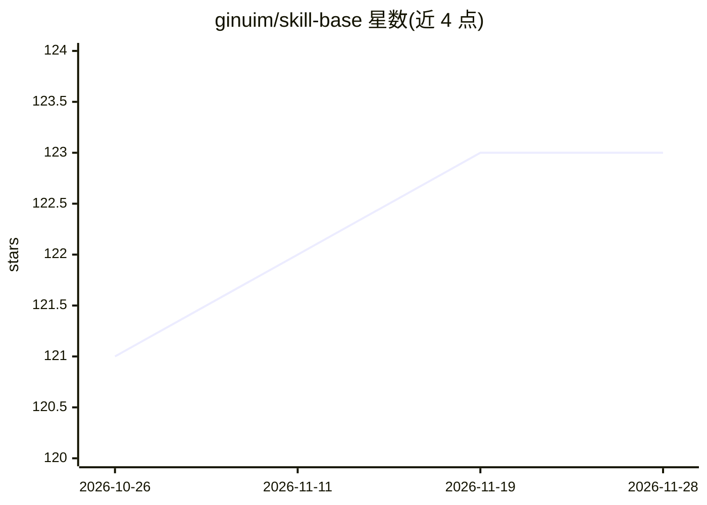

# ginuim/skill-base

⭐ 123 · JavaScript · 推送 2026-11-23 · [GitHub](https://github.com/ginuim/skill-base) · [官网](https://skillbase.reaidea.com/) · 个人维护 · 中文 README

**面向 AI 编码 agent 的私有 Skill 分发平台：发布/安装/更新/回滚**

由小型服务端与 skb CLI 组成的团队 Skill 分发平台：支持 Web 上传、skb publish 与公开仓库 GitHub 导入发布，通过 skb install/update/delete 按 Cursor、Claude Code、Codex、OpenClaw 等 agent 的 Skill 路径安装与追踪；提供版本切换、changelog、集合、权限（public/private）与版本 diff 页面，并暴露远程 MCP 端点供 agent 搜索、读取、发布 Skill。服务端为单 Node 进程，存储采用 SQLite + ZIP 归档，无 Redis/MySQL 等外部依赖；由独立开发者业余维护，无 on-call SLA。

## 筛选速览

| 维度 | 判定 | 备注 |
|---|---|---|
| AI 角色 | `ai-ecosystem` | LLM/agent 周边工具 |
| 许可风险 | `none` | — |
| 部署形态 | `library` | 以包/库形式分发 |
| 模型依赖 | — | README 未给出锁定关系 |
| 硬件要求 | — | 无带数字的原话,不猜 |
| 安装摩擦 | `low` | 无编译、无系统依赖或容器化 |
| 成熟度 | — | 结构信号不足 |

## 能力要点

- skb CLI 与 Web UI 双通道：发布、安装、更新、删除与版本回滚
- 远程 MCP 端点：agent 可搜索、读文件、对比版本、发布 Skill（PAT 鉴权）
- 单 Node 进程 + SQLite + ZIP 归档，备份即拷贝目录
- 公开 Skill 可无需 Node.js/skb 直接 ZIP 下载

## 适用场景

- 把散落在聊天记录和本地文件里的团队 Skill 统一为版本化资产
- 让 PM/QA 无需仓库权限即可获取安装最新 Skill
- 跨 Cursor/Claude Code/Codex 等多 agent 统一管理 Skill 安装路径

## 场景标签

`提示工程` · 领域:Agent 开发

## 证据(README 行号)

> L9: > Private distribution for Agent Skills. Publish once; install, update, and roll back across Cursor, Claude Code, Co
> L32: |**Install / update / delete**|`skb install` / `skb update` / `skb delete` with IDE Skill paths and local install t
> L74: - **SQLite + ZIP on disk** — `skills.db` indexes; each release is a versioned archive. Backup = copy one directory.

## 星数曲线

2026-10-26 121 → 2026-11-28 123（+2）

---
*卡片 v1 · prompt 1.4 · 生成 2026-11-28 · 置信度 high · 依据 README sha `e7a077c53c22` · [字段定义](../../DATASET.md)*
