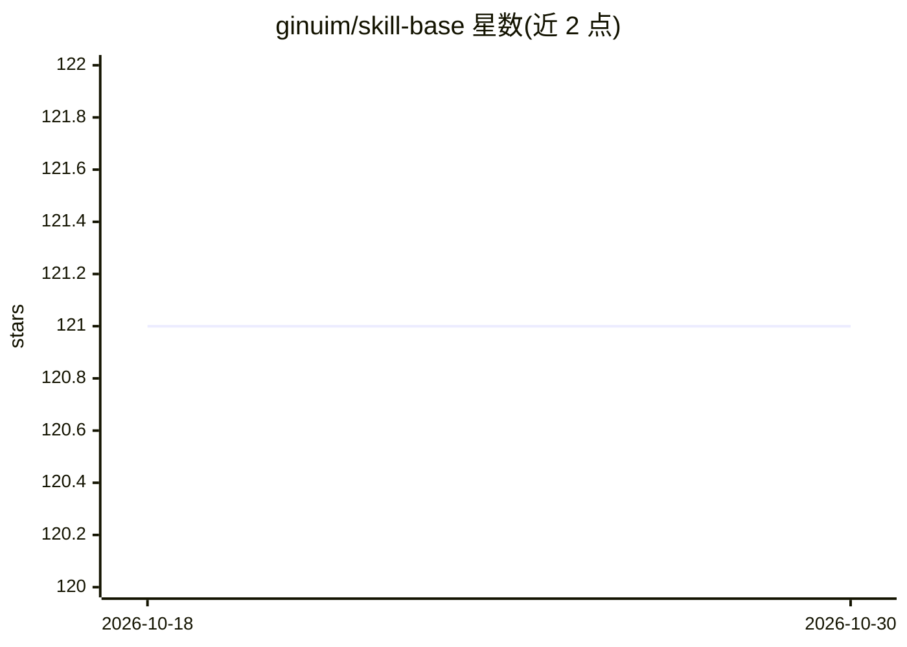

# ginuim/skill-base

⭐ 121 · Vue · 推送 2026-09-22 · [GitHub](https://github.com/ginuim/skill-base) · [官网](https://skillbase.reaidea.com/) · 个人维护 · 中文 README

**团队私有 Agent 技能分发平台：跨 Cursor/Claude Code 等发布安装技能**

面向已积累大量 AI 编码技能的团队，提供一个小型 Node.js 服务器加 skb CLI 与 Web UI，把技能变为可发布、版本化、可安装的团队资产：支持上传/GitHub 导入发布，skb install/update/delete 按 IDE 技能路径安装与本地跟踪，公开/私有权限区分。存储为 SQLite 加 ZIP 文件，单进程运行，无 Redis/MySQL 依赖。另有原生桌面客户端，技能可直接以 ZIP 下载。由兼职独立开发者维护，无 SLA 承诺。

## 筛选速览

| 维度 | 判定 | 备注 |
|---|---|---|
| AI 角色 | `ai-ecosystem` | LLM/agent 周边工具 |
| 许可风险 | `none` | — |
| 部署形态 | `library` | 以包/库形式分发 |
| 模型依赖 | — | README 未给出锁定关系 |
| 硬件要求 | — | 无带数字的原话,不猜 |
| 安装摩擦 | `low` | 无编译、无系统依赖或容器化 |
| 成熟度 | — | 结构信号不足 |

## 能力要点

- 跨 Cursor、Claude Code、Codex、OpenClaw 等统一发布/安装/更新/回滚技能
- SQLite + ZIP 单目录存储，单 Node 进程部署
- Web UI 提供搜索、版本切换、changelog、collection 与贡献者页面
- 提供原生桌面客户端与免 Node.js 的 ZIP 直接下载

## 适用场景

- 团队把散落的 Agent 技能统一为版本化资产
- 新成员通过 skb 一键安装团队技能集合
- PM/QA 无需 Git 权限即可浏览和下载技能

## 场景标签

`提示工程` · 领域:Agent 开发

## 证据(README 行号)

> L9: > Private distribution for Agent Skills. Publish once; install, update, and roll back across Cursor, Claude Code, Co
> L32: |**Install / update / delete**|`skb install` / `skb update` / `skb delete` with IDE Skill paths and local install t
> L65: - **Skills are the unit** — not a generic file dump or agent orchestrator.

## 星数曲线

2026-10-18 121 → 2026-10-30 121（+0）

---
*卡片 v1 · prompt 1.4 · 生成 2026-10-23 · 置信度 high · 依据 README sha `1274e0118bd7` · [字段定义](../../DATASET.md)*
