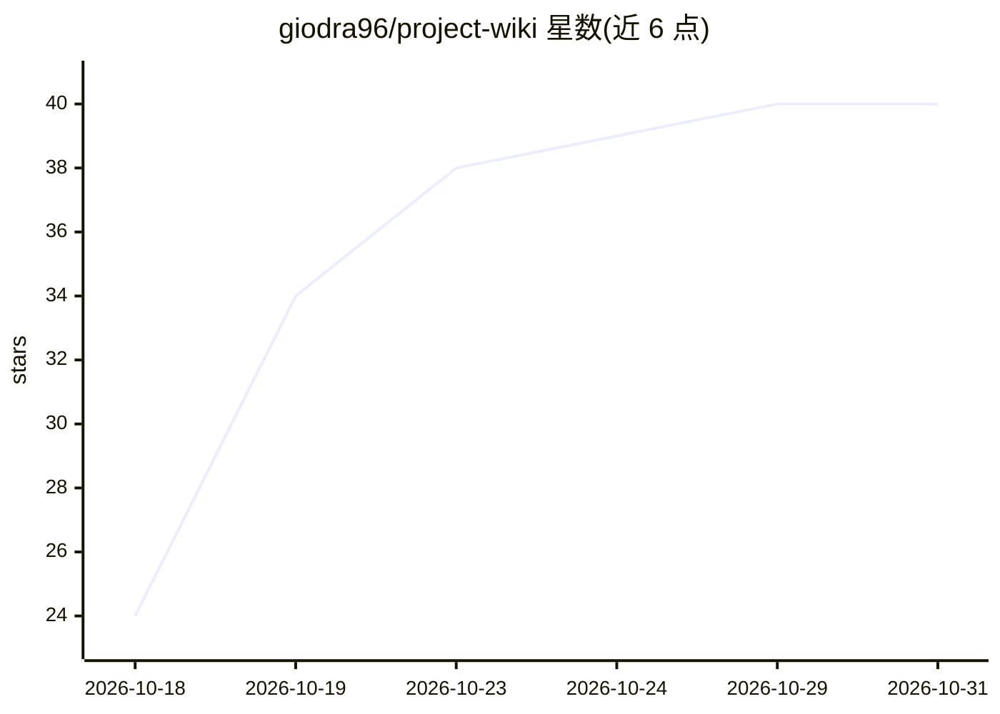

# giodra96/project-wiki

⭐ 40 · Python · MIT · 推送 2026-10-30 · [GitHub](https://github.com/giodra96/project-wiki) · 个人维护

**给 AI 编程 agent 的持久项目记忆技能，生成代码库旁的 wiki**

IDE 中立的 agent skill：在代码仓库的 .project-wiki/ 下生成并维护 agent 可读的知识库，把需求、决策、技术知识与项目历史转化为带永久 ID（REQ/ADR/CR）的结构化记录，并与源码路径显式链接。通过 INDEX.md 做渐进式披露以控制上下文占用；编码前自动读取相关上下文、变更后自动更新文档与追溯链；提供 init/scan/update/sync/maintain 五种模式。以 Markdown 存储，通过复制目录安装，兼容 Claude Code、Copilot、Cursor、Codex、Antigravity 等可读写仓库文件的对话式编程 agent。

## 筛选速览

| 维度 | 判定 | 备注 |
|---|---|---|
| AI 角色 | `ai-ecosystem` | LLM/agent 周边工具 |
| 许可风险 | `permissive` | MIT |
| 部署形态 | `library` | 以包/库形式分发 |
| 模型依赖 | — | README 未给出锁定关系 |
| 硬件要求 | — | 无带数字的原话,不猜 |
| 安装摩擦 | `low` | 无编译、无系统依赖或容器化 |
| 成熟度 | — | 结构信号不足 |

## 能力要点

- 需求/决策/变更记录带永久 ID 并显式链接源码路径
- INDEX.md 渐进式披露，仅加载最小相关文件集
- 编码前自动查询上下文、变更后自动更新文档与追溯
- init/scan/update/sync/maintain 五种命令模式

## 适用场景

- 让编程 agent 跨会话记住架构决策与项目约束
- 把会议纪要和聊天记录归类为规格、变更与决策记录
- 手动改代码后对账文档与实际实现的一致性

## 场景标签

`Agent 记忆` `知识库管理` · 领域:Agent 开发

## 证据(README 行号)

> L27: Project Wiki is an IDE-neutral agent skill for creating and maintaining an agent-readable knowledge base in `.proje
> L167: 3. **Active Agent Engine (Preflight, Auto-Update, Ingestion, `sync`, `maintain`)**:

## 星数曲线

2026-10-18 24 → 2026-10-31 40（+16）

---
*卡片 v1 · prompt 1.4 · 生成 2026-10-25 · 置信度 mid · 依据 README sha `f6edbd8ee56e` · [字段定义](../../DATASET.md)*
