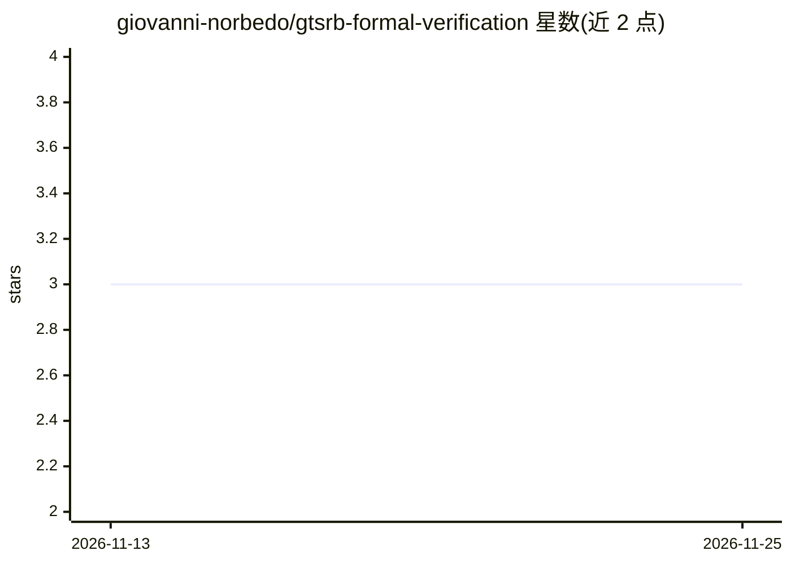

# giovanni-norbedo/gtsrb-formal-verification

⭐ 3 · Jupyter Notebook · 推送 2026-11-16 · [GitHub](https://github.com/giovanni-norbedo/gtsrb-formal-verification) · 个人维护

**GTSRB 交通标志神经网络的 PGD 鲁棒性与形式化验证课程项目**

的里雅斯特大学 Introduction to Machine Learning 课程项目，在 GTSRB 数据集的 5 类交通标志（STOP 等）上对比标准 ERM 模型与经 PGD 对抗训练的鲁棒模型。实验管线涵盖数据检查、训练、PGD 攻击、混淆矩阵，以及用 SMT 求解器 Marabou 对 ONNX 网络做精确形式化验证；以自包含可复现的 Jupyter notebook 实现，使用 uv 管理虚拟环境与依赖，附意大利语/英语技术报告与演示文稿。

## 筛选速览

| 维度 | 判定 | 备注 |
|---|---|---|
| AI 角色 | `ai-native` | 本体是模型或模型工具 |
| 许可风险 | `none` | — |
| 部署形态 | `None` |  |
| 模型依赖 | — | README 未给出锁定关系 |
| 硬件要求 | — | 无带数字的原话,不猜 |
| 安装摩擦 | `low` | 无编译、无系统依赖或容器化 |
| 成熟度 | — | 结构信号不足 |

## 能力要点

- PGD 经验鲁棒性评估与 Marabou SMT 精确形式化验证的结合
- ERM 标准模型与 PGD 对抗训练模型的对比实验
- 自包含可复现的 notebook 管线，uv 管理依赖
- 附意大利语与英语版技术报告及演示文稿

## 适用场景

- 复现 GTSRB 子集上的对抗训练与鲁棒性认证实验
- 学习用 Marabou 对 ONNX 神经网络做形式化验证
- 作为机器学习课程项目的参考实现

## 场景标签

`教程课程` · 领域:学习与行业

## 证据(README 行号)

> L7: Confronto tra modello standard (ERM) e modello robusto (*adversarial training* con PGD) su 5 classi di segnali strad
> L25: L'intera pipeline sperimentale (ispezione dati, training, attacchi PGD, matrici di confusione e verifica formale co

## 星数曲线

2026-11-13 3 → 2026-11-25 3（+0）

---
*卡片 v1 · prompt 1.4 · 生成 2026-11-22 · 置信度 high · 依据 README sha `688268a1c937` · [字段定义](../../DATASET.md)*
