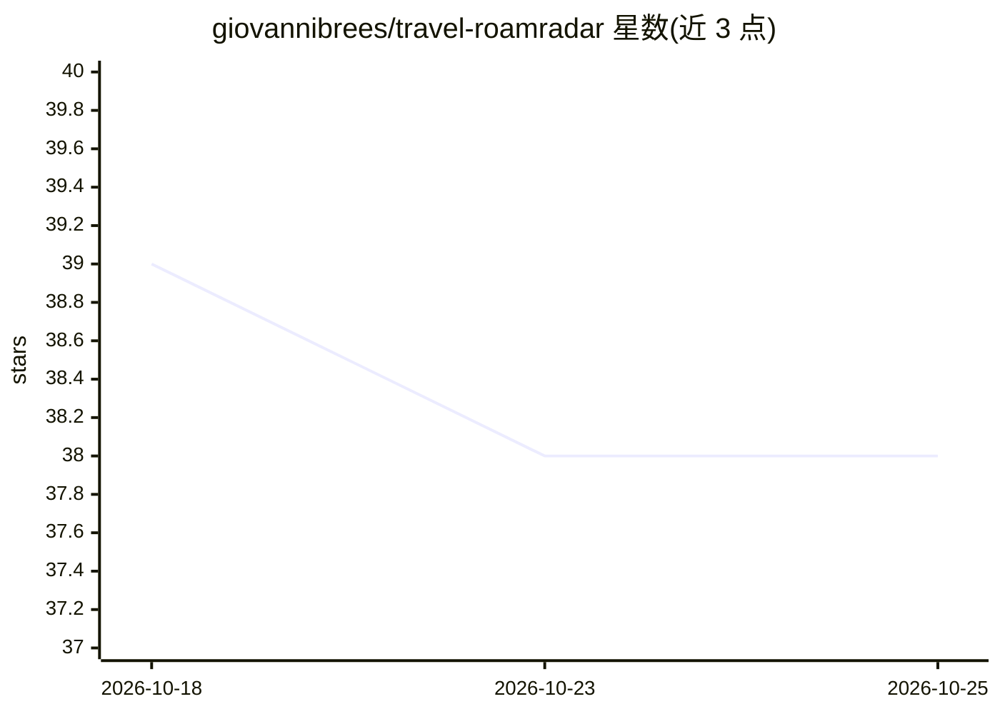

# giovannibrees/travel-roamradar

⭐ 38 · HTML · NOASSERTION · 推送 2026-07-24 · [GitHub](https://github.com/giovannibrees/travel-roamradar) · [官网](roamradar.app) · 个人维护

**自托管的个人旅行时间线应用，自动汇集航班酒店行程**

单人自托管旅行应用，以 Cloudflare Worker + KV 形式部署在用户自己的 Cloudflare 账号上，前端为单文件 vanilla JS，无构建步骤。功能包括：行程卡片、年度日历与出行天数统计、到访国家世界地图、每趟行程自动填充天气/汇率/插头类型/紧急电话、.ics 导出与订阅源、每周快照备份、PWA 安装。可选接入 Google Calendar/Gmail 自动导入行程，粘贴自有 Anthropic API key 后由 Claude 解析邮件中的预订确认（Booking.com、Airbnb、航司、Uber 等），每小时后台检查新邮件。手动记录的计划不会被同步覆盖。许可为 PolyForm Noncommercial 1.0.0。

## 筛选速览

| 维度 | 判定 | 备注 |
|---|---|---|
| AI 角色 | `ai-enhanced` | 去掉 AI 部分产品仍成立 |
| 许可风险 | `none` | NOASSERTION |
| 部署形态 | `library` | 以包/库形式分发 |
| 模型依赖 | locked-api |  |
| 硬件要求 | — | 无带数字的原话,不猜 |
| 安装摩擦 | `low` | 无编译、无系统依赖或容器化 |
| 成熟度 | — | 结构信号不足 |

## 能力要点

- 一键部署到自己的 Cloudflare 账号，数据全部存于自有 KV
- Google Calendar/Gmail 可选自动导入，Claude 解析邮件预订确认
- 手动添加的计划永不被自动同步改动
- PWA 安装到手机主屏，离线可用部分功能

## 适用场景

- 把自己的航班、酒店、行程集中到一条私人时间线
- 从邮箱和日历自动汇集旅行预订信息
- 与同伴通过只读链接共享实时行程

## 场景标签

 · 领域:旅行/个人软件

## 证据(README 行号)

> L3: > **A free, open-source, self-hosted personal travel app.** Keep every flight, hotel, ride, countdown, wishlist and 
> L156: - **Email → trip parsing (via Claude)** — paste your own Anthropic API key in
> L231: No. RoamRadar is fully usable by hand. Connecting Google Calendar and Gmail is

## 星数曲线

2026-10-18 39 → 2026-10-25 38（-1）

---
*卡片 v1 · prompt 1.4 · 生成 2026-10-25 · 置信度 mid · 依据 README sha `f1cad8bb27fd` · [字段定义](../../DATASET.md)*
