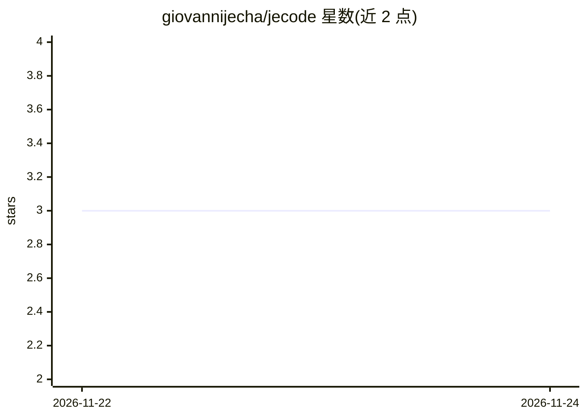

# giovannijecha/jecode

⭐ — · [GitHub]() · 个人维护

**终端编程 agent：描述任务，模型读写代码并执行命令**

用 Rust 编写的单文件原生可执行终端编程 agent：用户描述任务后，所选模型读取项目、编辑文件、运行命令并检查结果，每步以卡片与 diff 形式展示，权限分级控制其可修改范围。支持 OpenRouter、OpenAI、Anthropic API key 接入或 ChatGPT 账号登录，提供 Claude 订阅兼容路线（README 注明有 provider 限制）。经 npm 分发（需 Node.js 22+），也可从源码构建。README 声明项目处于实验阶段，macOS 交互使用仍待验证；隐私部分说明会话内容会发送给所选 provider。

## 筛选速览

| 维度 | 判定 | 备注 |
|---|---|---|
| AI 角色 | `ai-native` | 本体是模型或模型工具 |
| 许可风险 | `permissive` | — |
| 部署形态 | `library` | 以包/库形式分发 |
| 模型依赖 | locked-api |  |
| 硬件要求 | — | 无带数字的原话,不猜 |
| 安装摩擦 | `low` | 无编译、无系统依赖或容器化 |
| 成熟度 | `idea` | |

## 能力要点

- 单文件 Rust 原生可执行程序，无第三方 Rust crate
- 文件读取、搜索、命令执行以卡片呈现，编辑以 diff 呈现
- 多级权限控制（Workspace 级需批准项目外文件访问）
- 支持 skills/文件引用、MCP 连接、语言服务器与 AGENTS.md 项目指令

## 适用场景

- 让 agent 定位并修复测试失败的原因
- 用管道把 git diff 交给 agent 做代码审查
- 在终端全屏界面或单命令模式下执行编码任务

## 场景标签

`编码 Agent` `代码审查` · 领域:编码与开发

## 证据(README 行号)

> L5: Jecode is a coding agent for your terminal. You describe a task; the model you
> L6: choose reads your project, edits files, runs commands and checks
> L10: crates. Connect an OpenRouter, OpenAI or Anthropic API key, or sign in with

## 星数曲线

2026-11-22 3 → 2026-11-24 3（+0）

---
*卡片 v1 · prompt 1.4 · 生成 2026-11-22 · 置信度 high · 依据 README sha `3cccd833e975` · [字段定义](../../DATASET.md)*
