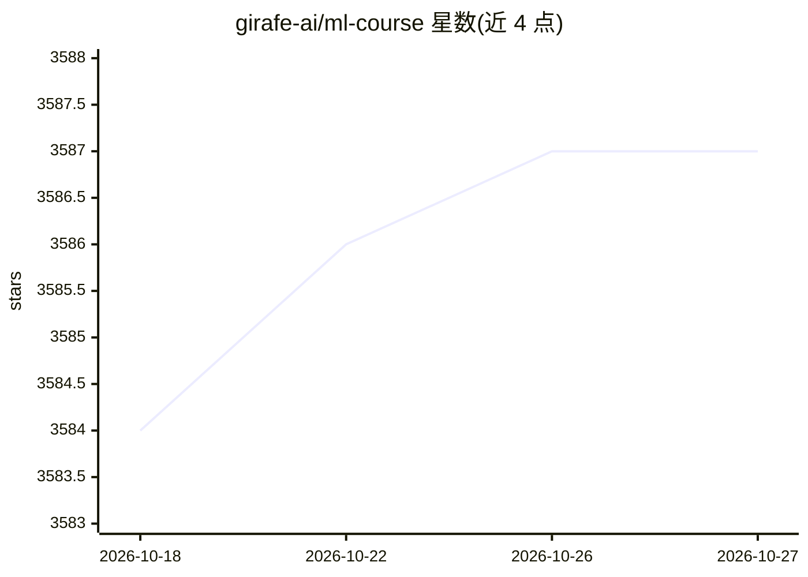

# girafe-ai/ml-course

⭐ 3,587 · Jupyter Notebook · MIT · 推送 2026-10-17 · [GitHub](https://github.com/girafe-ai/ml-course) · 组织维护

**开源机器学习课程（含深度学习）的讲义与作业材料库**

由 girafe-ai 团体维护的机器学习课程第一学期材料仓库，以周为单位的课程表组织内容，覆盖朴素贝叶斯与 kNN、线性回归与分类、SVM、PCA、梯度提升、深度学习入门、反向传播、Dropout/Batchnorm、词嵌入与 seq2seq 等主题，每周提供讲座录像、幻灯片与作业链接。面向课程学员与自学者，材料为俄语授课内容，配套 YSDA ML Book 等文献与考试大纲。README 未给出本仓库的安装或运行命令。

## 筛选速览

| 维度 | 判定 | 备注 |
|---|---|---|
| AI 角色 | `ai-knowledge` | 知识聚合/清单类 |
| 许可风险 | `permissive` | MIT |
| 部署形态 | `None` |  |
| 模型依赖 | — | README 未给出锁定关系 |
| 硬件要求 | — | 无带数字的原话,不猜 |
| 安装摩擦 | `low` | 无编译、无系统依赖或容器化 |
| 成熟度 | — | 结构信号不足 |

## 能力要点

- 按周组织的课程表，附讲座录像、幻灯片与带截止日期的作业
- 主题覆盖从经典 ML（kNN/线性模型/SVM/梯度提升）到深度学习（反向传播/embeddings/seq2seq）
- 列出参考书目（YSDA ML Book、Probabilistic ML、Deep Learning Book）与考试大纲入口

## 适用场景

- 系统学习从经典机器学习到深度学习的课程内容
- 获取带作业与录像的结构化自学材料
- 查找 ML 课程的大纲与文献参考

## 场景标签

`教程课程` · 领域:学习与行业

## 证据(README 行号)

> L3: # Machine Learning course
> L8: |Date|Content|Lecture video|Slides|WarmUp test|HW|Deadline|Comments|

## 星数曲线

2026-10-18 3,584 → 2026-10-27 3,587（+3）

---
*卡片 v1 · prompt 1.4 · 生成 2026-10-20 · 置信度 high · 依据 README sha `d7676723707e` · [字段定义](../../DATASET.md)*
