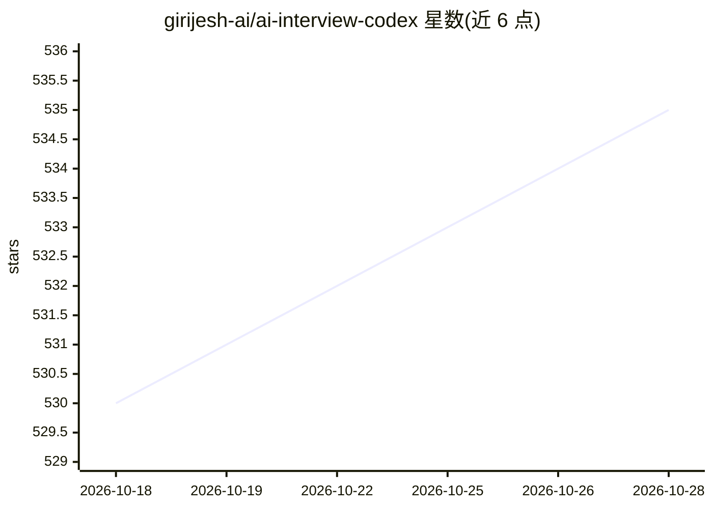

# girijesh-ai/ai-interview-codex

⭐ 535 · Python · 推送 2026-01-16 · [GitHub](https://github.com/girijesh-ai/ai-interview-codex) · 个人维护

**ML/AI 工程岗面试备考资料库：从算法到 LLM 系统设计**

面向 ML 工程师、转型软件工程师与求职研究者的面试准备资料合集，内容覆盖从零实现 ML 算法、神经网络组件、LLM 基础（分词/推理优化）、LoRA/QLoRA 微调、生产级 RAG、MCP 协议（面试指南/实现/银行案例/生产实践）、Agentic AI 系统迭代设计（10 轮演进）、MLOps 与 DSA。提供 4 周与 2 周学习计划、Jupyter notebook 可运行代码及面试问答条目，形式为阅读型仓库，无安装命令。

## 筛选速览

| 维度 | 判定 | 备注 |
|---|---|---|
| AI 角色 | `ai-knowledge` | 知识聚合/清单类 |
| 许可风险 | `none` | — |
| 部署形态 | `None` |  |
| 模型依赖 | — | README 未给出锁定关系 |
| 硬件要求 | — | 无带数字的原话,不猜 |
| 安装摩擦 | `low` | 无编译、无系统依赖或容器化 |
| 成熟度 | — | 结构信号不足 |

## 能力要点

- Agentic AI 系统的 10 轮迭代式设计示例（含成本演进数据）
- MCP 四篇专题：面试指南、动手实现、企业银行案例、生产实践
- ML 算法与神经网络组件从零实现，配 Jupyter 可运行代码
- 4 周与 2 周两套学习计划及 STAR 模板等面试辅助材料

## 适用场景

- 系统准备 ML/LLM 工程岗的技术面试
- 学习从零实现 ML 算法与 LLM 推理优化概念
- 按迭代方式演练 RAG/Agent 系统设计面试题

## 场景标签

`教程课程` · 领域:学习与行业

## 证据(README 行号)

> L3: A comprehensive collection of machine learning and AI interview preparation materials, covering ML coding, system de
> L7: This repository contains battle-tested interview preparation materials for ML/AI engineering roles, including:
> L322: This repo is perfect for:

## 星数曲线

2026-10-18 530 → 2026-10-28 535（+5）

---
*卡片 v1 · prompt 1.4 · 生成 2026-10-21 · 置信度 high · 依据 README sha `5b1f05efd66e` · [字段定义](../../DATASET.md)*
