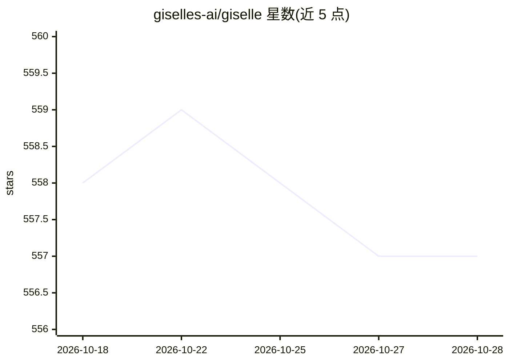

# giselles-ai/giselle

⭐ 557 · TypeScript · Apache-2.0 · 推送 2026-10-28 · [GitHub](https://github.com/giselles-ai/giselle) · [官网](https://giselles.ai) · 组织维护

**开源可视化 AI agent 工作流构建与运行平台**

开源的 AI agent studio：通过拖拽式界面创建与修改 agent，支持 GPT、Claude、Gemini 等多模型组合（需至少一个 AI provider API key），提供 GitHub AI Operations（自动化 issues/PR/部署）、知识库（含 GitHub 向量库集成）、团队协作（开发中）与模板中心（开发中）等功能。提供云服务与自托管两种使用方式；自托管通过 git clone 源码在本地运行（Node.js，访问 localhost:3000）。项目处于活跃开发阶段，采用 Apache 2.0 许可证。

## 筛选速览

| 维度 | 判定 | 备注 |
|---|---|---|
| AI 角色 | `ai-ecosystem` | LLM/agent 周边工具 |
| 许可风险 | `permissive` | Apache-2.0 |
| 部署形态 | `None` |  |
| 模型依赖 | locked-api |  |
| 硬件要求 | — | 无带数字的原话,不猜 |
| 安装摩擦 | `low` | 无编译、无系统依赖或容器化 |
| 成熟度 | `idea` | |

## 能力要点

- 拖拽式可视化 Agent Builder
- GPT/Claude/Gemini 多模型组合，agent 按任务选模型
- GitHub AI Operations：自动化 issues、PR 与部署
- GitHub 向量库集成的 Knowledge Store

## 适用场景

- 用可视化界面搭建多 agent 工作流而不写代码
- 自动化 GitHub issues、PR 与代码审查流程
- 从代码库自动生成 PRD、规格文档与发布说明
- 链式组合多个 AI 模型处理业务流程

## 场景标签

`多智能体` `Agent 框架` · 领域:Agent 开发

## 证据(README 行号)

> L8:  Giselle - Build and run AI workflows. Open source. | Product Hunt
> L21: Giselle is an open source AI for agentic workflows, enabling seamless human-AI collaboration.
> L48: - **🎨 Visual Agent Builder** - Create and modify agents in minutes using an intuitive drag-and-drop interface

## 星数曲线

2026-10-18 558 → 2026-10-28 557（-1）

---
*卡片 v1 · prompt 1.4 · 生成 2026-10-21 · 置信度 high · 依据 README sha `85074ff7d337` · [字段定义](../../DATASET.md)*
