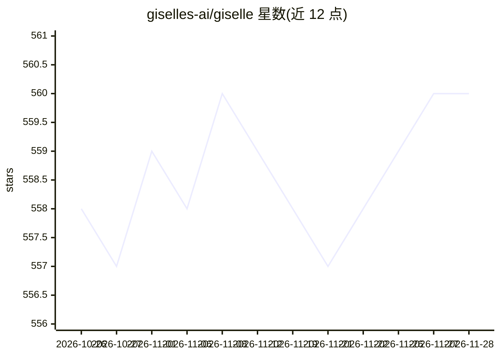

# giselles-ai/giselle

⭐ 560 · TypeScript · Apache-2.0 · 推送 2026-11-24 · [GitHub](https://github.com/giselles-ai/giselle) · [官网](https://giselles.ai) · 组织维护

**开源 AI agent 工作流构建工具，支持本地/自托管运行**

Giselle 是一个开源 AI 工作流工具，面向本地与自托管部署，提供可视化拖拽式 agent 构建器、多模型组合、知识库存储（含 GitHub 向量存储集成）、GitHub AI 操作（自动处理 issues、PR 与部署）及团队协作与模板中心（开发中）。运行需至少一个 AI 提供商 API key（OpenAI/Anthropic/Google AI）。托管云服务已停用，仅提供开源本地/自托管方式；仓库仍处于活跃开发中，公共路线图尚未定稿。

## 筛选速览

| 维度 | 判定 | 备注 |
|---|---|---|
| AI 角色 | `ai-ecosystem` | LLM/agent 周边工具 |
| 许可风险 | `permissive` | Apache-2.0 |
| 部署形态 | `None` |  |
| 模型依赖 | locked-api |  |
| 硬件要求 | — | 无带数字的原话,不猜 |
| 安装摩擦 | `low` | 无编译、无系统依赖或容器化 |
| 成熟度 | `idea` | |

## 能力要点

- 拖拽式可视化 agent 构建器
- 多模型组合（GPT/Claude/Gemini 等，agent 按任务选择模型）
- 知识库统一访问与检索，支持 GitHub 向量存储集成
- GitHub AI 操作：自动化 issues、PR 与部署

## 适用场景

- 通过 GitHub 工作流自动进行 AI 代码审查
- 从代码库自动生成 PRD、规格文档和发布说明
- 串联多个 AI 模型处理复杂业务流程
- 从网页与内部文档自动收集信息的研究助手

## 场景标签

`工作流自动化` `代码审查` `RAG` `AI 写作` · 领域:效率与自动化

## 证据(README 行号)

> L21: Giselle is an open-source AI workflow tool focused on local and self-hosted use, enabling seamless human-AI collabo
> L48: - **🎨 Visual Agent Builder** - Create and modify agents in minutes using an intuitive drag-and-drop interface
> L63: Giselle is available as open source for local use and self-hosting. The hosted cloud service has been discontinued.

## 星数曲线

2026-10-26 558 → 2026-11-28 560（+2）

---
*卡片 v1 · prompt 1.4 · 生成 2026-11-25 · 置信度 high · 依据 README sha `baf59dd10e1c` · [字段定义](../../DATASET.md)*
