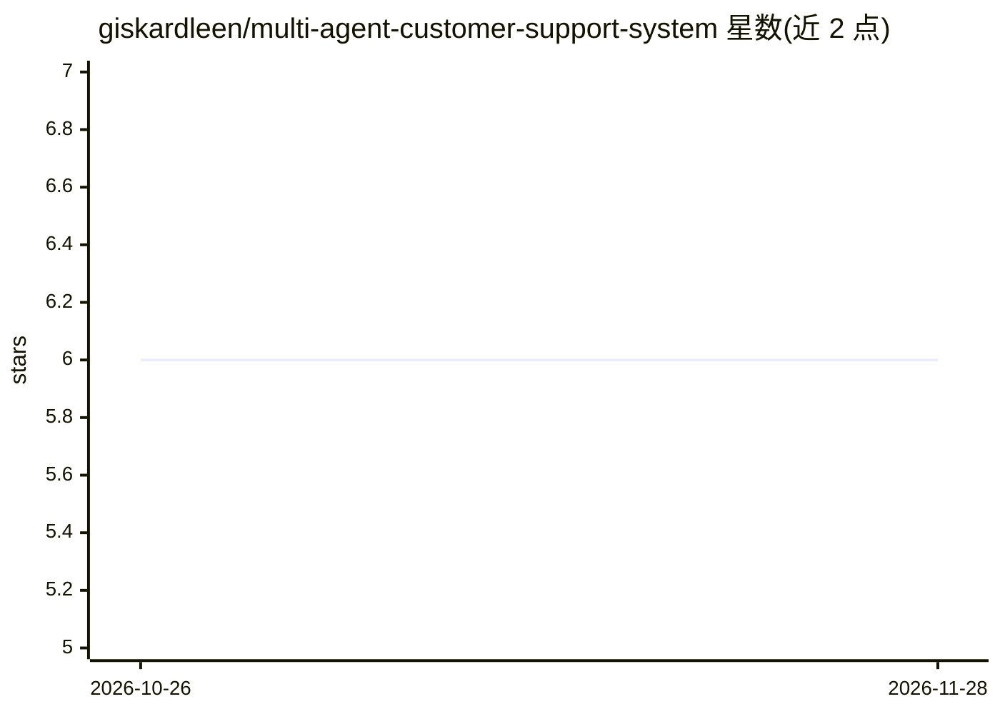

# giskardleen/multi-agent-customer-support-system

⭐ 6 · Python · 推送 2026-10-25 · [GitHub](https://github.com/giskardleen/multi-agent-customer-support-system) · 组织维护

**基于 Bedrock AgentCore 的多代理客服系统课程项目**

Udacity 课程 3.3 的结业项目，构建企业级多代理客服系统：Orchestrator 代理路由请求至库存/政策/退款/沟通四个专职代理，PolicyAgent 以 ThreadPoolExecutor 并行检索 3 个 Bedrock Knowledge Bases 实现多代理 RAG，DynamoDB WorkflowState 以乐观锁维护跨代理共享状态，Bedrock Guardrails 拦截有害内容与 PII，调用链路写入 X-Ray 与 CloudWatch。README 为含 TODO 的学生起步版，部署经 agentcore CLI 与 CDK。

## 筛选速览

| 维度 | 判定 | 备注 |
|---|---|---|
| AI 角色 | `ai-native` | 本体是模型或模型工具 |
| 许可风险 | `none` | — |
| 部署形态 | `library` | 以包/库形式分发 |
| 模型依赖 | locked-api |  |
| 硬件要求 | — | 无带数字的原话,不猜 |
| 安装摩擦 | `low` | 无编译、无系统依赖或容器化 |
| 成熟度 | — | 结构信号不足 |

## 能力要点

- 5 个 Strands 代理（Claude Haiku 4.5 编排 + Sonnet 4.5 执行）按路由规则分工
- PolicyAgent 并行扇出 3 个 KB 检索子代理并按相关性去重合并
- DynamoDB 共享 WorkflowState 支持版本条件写实现并发一致性
- Guardrails 拦截有害内容、PII 脱敏与话题阻断，全链路 X-Ray 追踪

## 适用场景

- 按课程任务实现多代理编排与部署逻辑
- 学习 Bedrock AgentCore 运行时、Guardrails 与 S3 Vectors KB 的组合使用
- 参考多代理 RAG 并行检索与共享状态的设计模式

## 场景标签

`多智能体` `RAG` · 领域:Agent 开发

## 证据(README 行号)

> L5: A production-grade multi-agent customer support system built with the Strands Agents SDK and Amazon Bedrock AgentCor
> L21: |**OrchestratorAgent**|Claude Haiku 4.5|Routes requests, creates/updates WorkflowState|`initialize_session`, `route
> L57: This is the unfinished student starter: complete the TODOs in `src/agent_orchestrator.py`. The CLI configuration an

## 星数曲线

2026-10-26 6 → 2026-11-28 6（+0）

---
*卡片 v1 · prompt 1.4 · 生成 2026-11-20 · 置信度 high · 依据 README sha `559d1dd4e7b5` · [字段定义](../../DATASET.md)*
