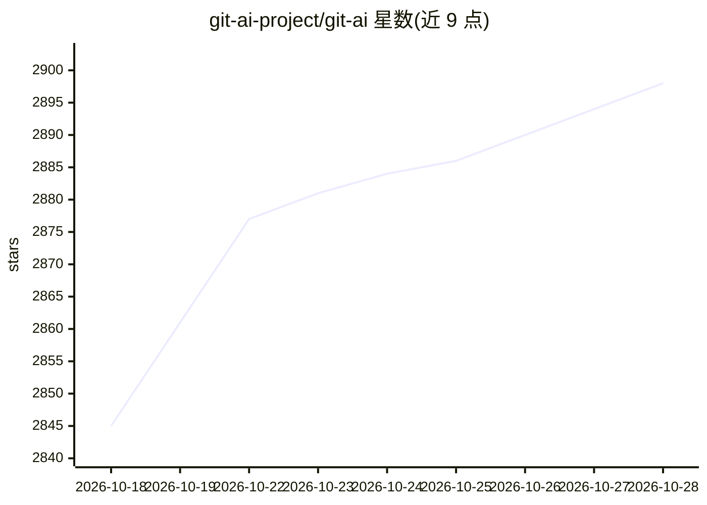

# git-ai-project/git-ai

⭐ 2,898 · Rust · Apache-2.0 · 推送 2026-10-27 · [GitHub](https://github.com/git-ai-project/git-ai) · [官网](https://usegitai.com) · 个人维护

**Git 扩展：追踪并归因仓库中 AI 生成的每一行代码**

开源 git 扩展，通过 Git Notes 将每行 AI 生成代码关联到生成它的 agent、模型与 prompt，不依赖 Git hooks、不包装 Git 二进制。coding agent 调用 git-ai checkpoint 上报自己写下的行，commit 时自动附加行级归因，并在 rebase/squash/stash 等改写操作中迁移归因。提供 git ai blame（git blame 的替代）、stats 聚合命令与 VS Code 等编辑器插件展示；本地优先、无需登录。另设付费的 Teams/企业版，提供跨仓库聚合分析与 prompt 存储等。已知限制：git mv、filter-repo 等尚不追踪。

## 筛选速览

| 维度 | 判定 | 备注 |
|---|---|---|
| AI 角色 | `ai-ecosystem` | LLM/agent 周边工具 |
| 许可风险 | `permissive` | Apache-2.0 |
| 部署形态 | `None` |  |
| 模型依赖 | locked-api |  |
| 硬件要求 | — | 无带数字的原话,不猜 |
| 安装摩擦 | `low` | 无编译、无系统依赖或容器化 |
| 成熟度 | — | 结构信号不足 |

## 能力要点

- 行级 AI 归因存入 Git Notes，关联 agent、模型与 prompt
- 不使用 Git hooks、不包装 Git 二进制，无性能开销
- git ai blame 为 git blame 的替代命令，支持标准参数
- rebase/squash/stash/cherry-pick 等改写操作下归因保留

## 适用场景

- 我想知道仓库里哪些代码是 AI 写的、由哪个模型和 prompt 生成
- 团队统计 % AI 代码、接受率与 token 成本
- code review 时回溯某段 AI 代码的原始 prompt

## 场景标签

`代码审查` `数据分析` · 领域:效率与自动化

## 证据(README 行号)

> L6: Git AI is an open source git extension that tracks the AI-generated code in your repositories. After installing the 
> L156: 1. Coding Agents call `git-ai checkpoint` whenever they write code or modify files with bash scripts.
> L157: 1. On commit, Git AI stores line-level attribution data in Git Notes, linking each line of AI-generated code to th

## 星数曲线

2026-10-18 2,845 → 2026-10-28 2,898（+53）

---
*卡片 v1 · prompt 1.4 · 生成 2026-10-21 · 置信度 high · 依据 README sha `9629b0e3a014` · [字段定义](../../DATASET.md)*
