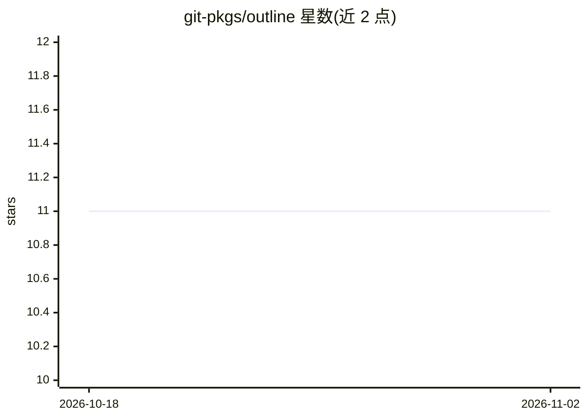

# git-pkgs/outline

⭐ 11 · Go · MIT · 推送 2026-10-27 · [GitHub](https://github.com/git-pkgs/outline) · [官网](https://git-pkgs.dev) · 组织维护

**把源码树压缩为结构骨架供 LLM 使用的 Go 库与 CLI**

Pure Go 库（无 CGo），用 gotreesitter 解析源码：剥离函数/方法体，保留签名、类型、注释与导入，把整个代码仓库压缩为适合喂给 LLM 的 Markdown/XML 文档；遵循 .gitignore，跳过二进制与超大文件。另提供 Build 生成带调用关系的代码图，支持 Def/Callers/Callees/Affected/Path 查询。35 种语言支持体剥离，导入与引用提取覆盖 24 种。附带 CLI 二进制与安装命令。

## 筛选速览

| 维度 | 判定 | 备注 |
|---|---|---|
| AI 角色 | `ai-ecosystem` | LLM/agent 周边工具 |
| 许可风险 | `permissive` | MIT |
| 部署形态 | `library` | 以包/库形式分发 |
| 模型依赖 | — | README 未给出锁定关系 |
| 硬件要求 | — | 无带数字的原话,不猜 |
| 安装摩擦 | `low` | 无编译、无系统依赖或容器化 |
| 成熟度 | — | 结构信号不足 |

## 能力要点

- 35 种语言的函数体剥离，保留签名/类型/注释/导入
- Pack 打包代码树为 Markdown/XML，遵循 .gitignore
- Build 生成代码图，支持 Callers/Callees/Affected/Path 查询
- 提供 outline CLI 与 go install 安装方式

## 适用场景

- 把大型代码库压缩后交给 LLM 做代码理解或问答
- 分析某个函数的调用者与受影响的调用链
- 提取源码导入与成员引用做依赖分析

## 场景标签

 · 领域:开发者工具/代码分析

## 证据(README 行号)

> L3: Reduce a source tree to a structural skeleton suitable for feeding to an LLM.
> L7: Pure Go, no CGo. Parsing is done by [gotreesitter], file selection respects

## 星数曲线

2026-10-18 11 → 2026-11-02 11（+0）

---
*卡片 v1 · prompt 1.4 · 生成 2026-11-02 · 置信度 high · 依据 README sha `82bc95f963eb` · [字段定义](../../DATASET.md)*
